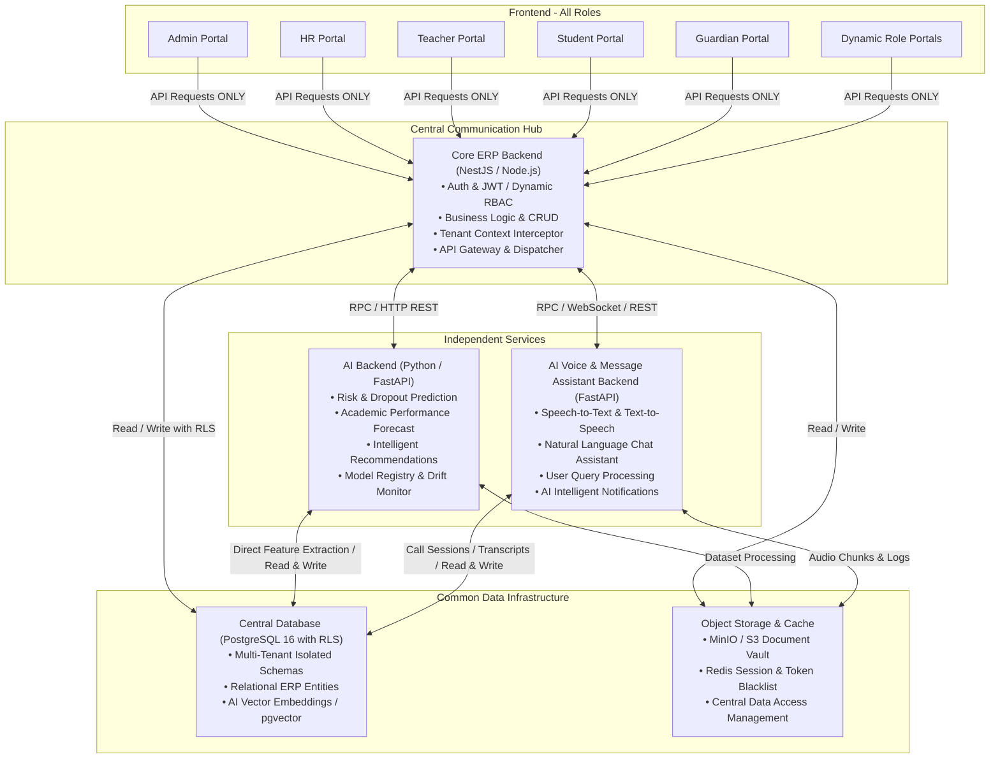
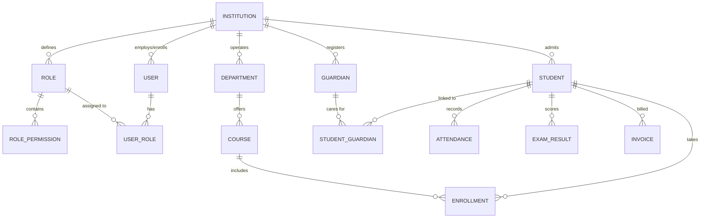

# Complete ERP SaaS Admin Panel Audit & Technical Architecture Analysis

> **Document Type:** Production Readiness Audit, System Architecture & Engineering Specification  
> **System Name:** Multi-Tenant ERP-Based SaaS Institute Management System with Modular AI & Voice/Message Assistant  
> **Codebase Inspected:** `EDU-ADMIN-main` (Next.js 16 App Router Frontend)  
> **Audit Date:** November 2026  
> **Audit Status:** Verified & Updated with Architectural Blueprint  

---

## Executive Summary

A forensic, file-by-file, folder-by-folder engineering audit of the `EDU-ADMIN-main` codebase was conducted. The current repository contains **32 institutional modules**, encompassing **296 React/JSX source files** and **35,169 lines of frontend code** under `src/app/admin/`.

### Key Audit Verdict:
1. **100% UI Prototype Reality:** Every single module currently functions strictly as a client-side presentation prototype. There are **0 live API calls (`fetch` or `axios`)** across all 296 administrative files. All interactive elements (tables, charts, modals, badges, cards) read and write to temporary in-memory React `useState` or static mock constants.
2. **Zero Authentication & Open Administrative Access:** There is **no `/login` or authentication route**. The root route (`/`) remains the unconfigured default Next.js template. Any visitor directly browsing to `http://localhost:3000/admin/...` is granted unrestricted super-admin level access. Role-based guards and middleware do not exist.
3. **Monolithic Admin Bundling Without Role Portals:** Despite requirements for separate portals (Super Admin, Institute Admin, Teacher, Student, Guardian, HR, Staff), all existing functionality is lumped into a single monolithic `/admin` directory. The active layout (`AdminLayoutClient`) renders all 32 modules on a universal sidebar for any viewer.
4. **Universal Role & Credential Requirement:** Every single role—both standard roles and dynamically created roles—must possess its own unique credentials (username and cryptographic password). Currently, this provisioning engine is completely absent.
5. **Zero Multi-Tenant SaaS Isolation:** No tenant context (`tenant_id`, `institution_id`) exists in state, local storage, cookies, or route parameters. There is no subdomain routing mechanism (`tenant.domain.com`) or tenant database isolation schema.
6. **Critical Logic & UI Deficiencies:** Broken links (leading to 404s), non-functional buttons (`+ Add Student` has no `onClick`), hardcoded plain-text passwords in source code, and a dynamic role permission matrix that only tracks 5 hardcoded modules out of 32 were uncovered.

---

## 1. Modular System Architecture & Workflow Process
### Modular ERP System with AI and Voice & Message Assistant

The system is engineered as a modern, decoupled, multi-tier enterprise ecosystem governed by strict architectural boundaries:



### 1.1 Frontend (All Roles)
All user role interfaces reside within a unified, cleanly modularized frontend codebase (`src/app/`):
- Admin (Super Admin & Institute Admin)
- HR & Payroll Staff
- Teachers & Academic Faculty
- Students
- Guardians / Parents
- Any dynamically created custom roles (e.g., Exam Controller, Hostel Warden, Librarian)

**Strict Rule:** The Frontend communicates **EXCLUSIVELY with the Core ERP Backend**. The Frontend is strictly forbidden from directly connecting to the AI Backend, Voice Assistant Backend, or the Shared Data Infrastructure.

### 1.2 Core ERP Backend (Central Hub)
The Core ERP Backend acts as the **Central Communication Hub** of the entire enterprise ecosystem. It manages:
- Central business logic and transactional integrity
- Unified Authentication (JWT, MFA, session management)
- Authorization & Dynamic RBAC (Role-Based Access Control)
- Multi-tenant context extraction and validation
- API orchestration and routing to specialized backend microservices

The Core ERP Backend is connected to three distinct components:
1. **AI Backend**
2. **AI Voice & Message Assistant Backend**
3. **Shared Data Infrastructure**

### 1.3 AI Backend
An independent backend microservice (Python / FastAPI) dedicated to all AI/ML/DL execution:
- Student Academic Risk Prediction
- Student Performance Forecasting & GPA Trajectory
- Dropout Risk Detection & Early Warning System
- Intelligent Learning & Course Recommendations
- Academic & Departmental Analytics

**Dual Communication Paths for AI Backend:**
1. Exchanges request and response payloads with the **Core ERP Backend**.
2. Directly performs **Read/Write** operations on the **Shared Data Infrastructure** for model feature store reads, dataset extraction, embedding searches, and saving prediction logs.

### 1.4 AI Voice & Message Assistant Backend
A dedicated, independent backend service (Python / FastAPI / WebSockets) engineered for real-time conversational intelligence:
- Real-time Voice Assistant & Telephony/SIP interaction
- Text-based Interactive Chat Assistant
- Speech-to-Text (STT) and Text-to-Speech (TTS)
- Institutional knowledge queries (Student info, fee status, exam schedules)
- Complaint & Objection intake and classification
- AI-powered institutional messaging and automated notifications

**Dual Communication Paths for Voice & Message Assistant:**
1. Communicates via API / WebSockets with the **Core ERP Backend**.
2. Directly performs **Read/Write** operations on the **Shared Data Infrastructure** for call logging, transcript persistence, session state, and document embeddings.

### 1.5 Shared Data Infrastructure
The common data foundation for the entire platform:
- **Central Database (PostgreSQL 16):** Houses relational ERP data with Row-Level Security (RLS) and vector storage (`pgvector`).
- **Data Storage:** S3 / MinIO object storage for student documents, voice call recordings, and academic certificates.
- **Shared Data Services & Cache:** Redis for session blacklisting, rate limiting, and tenant resolution caching.
- **Data Access Management:** Standardized data access policies ensuring tenant isolation and referential integrity across all three backends.

### 1.6 Complete System Workflow (Step-by-Step)
1. **Step 1:** The user triggers an action on the Frontend.
2. **Step 2:** The Frontend sends an authenticated HTTP/WebSocket request **ONLY to the Core ERP Backend**.
3. **Step 3:** The Core ERP Backend verifies tenant context, validates JWT/permissions, and executes standard business logic.
4. **Step 4:** If the task requires AI intelligence (e.g., student risk prediction, course recommendation), the Core ERP Backend dispatches a request to the **AI Backend**.
5. **Step 5:** If the task involves voice processing, interactive chat, or automated messaging, the Core ERP Backend routes the request to the **Voice & Message Assistant Backend**.
6. **Step 6:** As required, the **Core ERP Backend**, **AI Backend**, and **Voice & Message Assistant Backend** each directly access the **Shared Data Infrastructure** for reading training data, verifying records, or storing analytics/transcripts.
7. **Step 7:** The specialized backend finishes computation and returns the structured result to the **Core ERP Backend**.
8. **Step 8:** The Core ERP Backend performs final response mapping and delivers the consolidated response to the **Frontend**, which renders the UI for the user.

### 1.7 Architectural Commandments (Non-Negotiable Rules)
1. Frontend can communicate **ONLY with Core ERP Backend**.
2. Core ERP Backend acts as the **Central Communication Hub**.
3. AI Backend must remain a **separate and independent service**.
4. Voice & Message Assistant Backend must remain a **separate and independent service**.
5. All three Backend Services must have **direct connections to Shared Data Infrastructure**.
6. **No direct Frontend-to-AI, Frontend-to-Voice, or Frontend-to-Database connection is permitted**.
7. Each Backend must maintain its own **independent codebase and domain responsibilities**.

---

## 2. Existing Codebase Audit (All 32 Admin Modules)

A comprehensive scan of `src/app/admin/` reveals 32 modules containing 296 files and 35,169 lines of code.

| # | Module Folder | Subroutes | Files | Code Lines | Live Fetch | Interactive Elements | Mock State Variables |
|---|---|---|---|---|---|---|---|
| 1 | `ai-analytics` | 10 | 14 | 997 | No (0) | Btns: 5, Inputs: 3, Tables: 1 | `Inline Objects` |
| 2 | `api` | 10 | 13 | 745 | No (0) | Btns: 10, Inputs: 5, Tables: 1 | `Inline Objects` |
| 3 | `application` | 8 | 9 | 1,228 | No (0) | Btns: 40, Inputs: 24, Tables: 9 | `initialApplications, initialApprovals, initialCards` |
| 4 | `attendance` | 1 | 1 | 304 | No (0) | Btns: 2, Inputs: 0, Tables: 1 | `mockStudents` |
| 5 | `certificate` | 4 | 7 | 854 | No (0) | Btns: 3, Inputs: 3, Tables: 2 | `Inline Objects` |
| 6 | `classroom` | 6 | 7 | 1,949 | No (0) | Btns: 45, Inputs: 17, Tables: 3 | `mockCourses, mockDiscussions, mockQueries` |
| 7 | `document` | 5 | 8 | 951 | No (0) | Btns: 3, Inputs: 3, Tables: 2 | `Inline Objects` |
| 8 | `examination` | 9 | 10 | 2,670 | No (0) | Btns: 50, Inputs: 29, Tables: 10 | `mockCourses, mockHalls, mockImprovementApps` |
| 9 | `finance` | 5 | 6 | 1,872 | No (0) | Btns: 44, Inputs: 53, Tables: 9 | `initialInvoices, initialPayments, mockTransactions` |
| 10 | `guardian` | 4 | 4 | 424 | No (0) | Btns: 16, Inputs: 4, Tables: 1 | `mockCredentials, mockData, mockGuardians` |
| 11 | `hostel` | 6 | 9 | 838 | No (0) | Btns: 3, Inputs: 3, Tables: 1 | `Inline Objects` |
| 12 | `hr` | 7 | 10 | 936 | No (0) | Btns: 3, Inputs: 2, Tables: 1 | `Inline Objects` |
| 13 | `import-export` | 7 | 10 | 1,045 | No (0) | Btns: 6, Inputs: 5, Tables: 2 | `Inline Objects` |
| 14 | `institution` | 7 | 7 | 379 | No (0) | Btns: 6, Inputs: 3, Tables: 1 | `Inline Objects` |
| 15 | `inventory` | 6 | 9 | 921 | No (0) | Btns: 3, Inputs: 3, Tables: 1 | `Inline Objects` |
| 16 | `library` | 6 | 7 | 1,170 | No (0) | Btns: 31, Inputs: 25, Tables: 5 | `mockBooks, mockDocuments, mockEbooks` |
| 17 | `lms` | 8 | 9 | 3,244 | No (0) | Btns: 69, Inputs: 58, Tables: 5 | `mockAssignments, mockCodingTasks, mockGeneratedQuizzes` |
| 18 | `monitoring` | 9 | 12 | 767 | No (0) | Btns: 5, Inputs: 2, Tables: 1 | `Inline Objects` |
| 19 | `notice` | 6 | 9 | 742 | No (0) | Btns: 3, Inputs: 3, Tables: 2 | `Inline Objects` |
| 20 | `notification` | 8 | 11 | 1,263 | No (0) | Btns: 8, Inputs: 9, Tables: 1 | `Inline Objects` |
| 21 | `objection` | 7 | 10 | 504 | No (0) | Btns: 7, Inputs: 4, Tables: 1 | `Inline Objects` |
| 22 | `reports` | 11 | 14 | 1,188 | No (0) | Btns: 8, Inputs: 6, Tables: 1 | `Inline Objects` |
| 23 | `research` | 6 | 9 | 998 | No (0) | Btns: 3, Inputs: 2, Tables: 1 | `Inline Objects` |
| 24 | `scholarship` | 6 | 7 | 2,209 | No (0) | Btns: 26, Inputs: 24, Tables: 6 | `initialApplications, initialApprovals, initialCriteria` |
| 25 | `settings` | 13 | 17 | 973 | No (0) | Btns: 2, Inputs: 6, Tables: 0 | `Inline Objects` |
| 26 | `student` | 3 | 3 | 354 | No (0) | Btns: 8, Inputs: 2, Tables: 0 | `mockStudents` |
| 27 | `system` | 4 | 9 | 1,682 | No (0) | Btns: 27, Inputs: 47, Tables: 3 | `initialRoles, initialUsers` |
| 28 | `teacher` | 3 | 3 | 394 | No (0) | Btns: 5, Inputs: 1, Tables: 2 | `mockEvaluations, mockTeachers, mockWorkload` |
| 29 | `transport` | 6 | 9 | 899 | No (0) | Btns: 3, Inputs: 3, Tables: 1 | `Inline Objects` |
| 30 | `voice-ai` | 20 | 24 | 1,058 | No (0) | Btns: 9, Inputs: 3, Tables: 2 | `Inline Objects` |
| 31 | `voting` | 6 | 9 | 797 | No (0) | Btns: 3, Inputs: 2, Tables: 1 | `Inline Objects` |
| 32 | `workflow` | 7 | 10 | 814 | No (0) | Btns: 5, Inputs: 2, Tables: 1 | `Inline Objects` |

---

## 3. Feature-by-Feature Functionality Assessment

| ERP Feature Group | Specific Module | Status | UI Status | Data Persistence | Required Backend Service |
|---|---|---|---|---|---|
| **Core Academics** | Student Information | Partial | Working UI, dead '+ Add' button | None (In-memory) | `StudentService.createStudent` |
| | Student Analytics | Functional Prototype | Working metrics & charts | None (Static) | `AnalyticsService.getStudentKPIs` |
| | ID Management | Functional Prototype | Card preview works | None (Static) | `IDCardService.generateBarcode` |
| | Teacher Directory | Functional Prototype | Filterable teacher list | None (Static) | `TeacherService.findAll` |
| | Classroom Management | Functional Prototype | Schedules & room allocation | None (Static) | `ClassroomService.allocateRoom` |
| **Enrollment & Admissions** | Applications | Functional Prototype | Multi-step review tabs | None (Static) | `AdmissionService.processApplication` |
| | Objection Handling | Functional Prototype | Status tracking badges | None (Static) | `ObjectionService.updateStatus` |
| **Attendance & Exams** | Attendance Records | Functional Prototype | Class attendance matrix | None (Static) | `AttendanceService.recordBulk` |
| | Examination Setup | Functional Prototype | Exam schedules & gradebooks | None (Static) | `ExamService.publishResults` |
| | Certificate Generation | Functional Prototype | PDF layout template | None (Static) | `CertificateService.renderPDF` |
| **Finance & Billing** | Fee Structure | Functional Prototype | Fee head breakdown | None (Static) | `FinanceService.createFeeHead` |
| | Invoices & Payments | Functional Prototype | Invoice list & collection | None (Static) | `PaymentService.createInvoice` |
| | Transactions | Functional Prototype | Audit ledger list | None (Static) | `TransactionService.getLedger` |
| **HR & Operations** | HR Directory & Payroll | Functional Prototype | Staff directory & salary breakdown | None (Static) | `HRService.processPayroll` |
| | Inventory & Assets | Functional Prototype | Stock tracking & supplier list | None (Static) | `InventoryService.adjustStock` |
| | Hostel Management | Functional Prototype | Room allocations & bed counts | None (Static) | `HostelService.allocateBed` |
| | Transport Routes | Functional Prototype | Fleet & bus route tables | None (Static) | `TransportService.assignRoute` |
| **Library & LMS** | Library Catalog | Functional Prototype | Issue/return logs & book search | None (Static) | `LibraryService.issueBook` |
| | LMS Courses | Functional Prototype | Syllabus, assignments, lessons | None (Static) | `LMSService.createCourse` |
| **Governance & Admin** | System Role Permission | Broken / Partial | 5 modules only; changes evaporate | None (Static) | `RBACService.updateRolePermissions` |
| | Guardian Portal Access | Vulnerable Prototype | Plain-text passwords hardcoded | None (Static) | `AuthService.generateCredentials` |
| | Institution Settings | Functional Prototype | Campus profiles & meta | None (Static) | `TenantService.updateTenantProfile` |
| | Security Settings | Broken (404 via sidebar) | Route mismatch | None | `SecurityService.getMFAConfig` |
| | Research Features | Broken (404 via sidebar) | Route mismatch | None | `ResearchService.getGrants` |

---

## 4. Identified Bugs, Technical Issues & Engineering Solutions

As an enterprise software engineering principle, every identified defect is paired with its concrete architectural fix:

### 4.1 Dead Routes & 404 Links — Analysis & Engineering Fix
1. **Defect: Sidebar Link to Missing Security Page (`/admin/security` → 404)**
   - *Root Cause:* `src/lib/moduleData.jsx` defines a route pointing to `/admin/security`, but the page exists at `/admin/settings/security/page.jsx`.
   - *Engineering Fix:* Update `src/lib/moduleData.jsx` to correctly point to `/admin/settings/security`. Additionally, add a Next.js rewrite rule in `next.config.js` mapping `/admin/security` → `/admin/settings/security` for backwards URL tolerance.
2. **Defect: Sidebar & In-Module Links to Missing Research Features (`/admin/research/features` → 404)**
   - *Root Cause:* `src/lib/moduleData.jsx` and `src/app/admin/research/_components/ResearchList.jsx` link to `/admin/research/features`, which has no folder.
   - *Engineering Fix:* Correct the link in both files to `/admin/research`, where the research dashboard and grant listing live.
3. **Defect: Internal Dead Link in Voting Module (`/admin/voting/features` → 404)**
   - *Root Cause:* `VotingList.jsx` links to `/admin/voting/features`.
   - *Engineering Fix:* Update link to `/admin/voting` (the main active elections overview).

### 4.2 Non-Functional Elements (Dead Buttons) — Analysis & Engineering Fix
1. **Defect: `+ Add Student` Dead Button (`src/app/admin/student/information/page.jsx`)**
   - *Root Cause:* The button has no `onClick` handler.
   - *Engineering Fix:* Bind the button to an `AddStudentModal` component backed by `react-hook-form` + `zod` schema. Upon submission, it triggers `POST /api/v1/admissions/enroll` which creates the student record, generates the student credentials and guardian credentials, and dispatches them via SMS/Email.
2. **Defect: `Send Credentials` Dead Button (`src/app/admin/guardian/portal-access/page.jsx`)**
   - *Root Cause:* No API call or dispatch handler.
   - *Engineering Fix:* Connect to `POST /api/v1/auth/dispatch-credentials` with recipient ID and delivery channel ('SMS' | 'EMAIL').

### 4.3 Severe Security & Data Integrity Anti-Patterns — Analysis & Engineering Fix
1. **Defect: Hardcoded Plain-Text Passwords in Source Code**
   - *Location:* `src/app/admin/guardian/portal-access/page.jsx` (`mockCredentials = [{ password: 'pass@1234' }]`).
   - *Engineering Fix:* Remove all password fields from client-rendered mock and live tables. In production, passwords are NEVER returned over API endpoints. The system only returns `credentials_dispatched_at: timestamp` and `status: 'INVITED' | 'ACTIVE'`. Password hashes are created via Argon2id on the Core ERP Backend and stored securely in PostgreSQL.
2. **Defect: Truncated Master Permission Matrix (5 of 32 Modules Only)**
   - *Location:* `src/app/admin/system/role-permission/page.jsx`.
   - *Engineering Fix:* Expand `masterModules` dynamically to fetch from `GET /api/v1/system/modules`, which returns all 32 institutional modules. Each module supports 6 granular capabilities (`create`, `read`, `update`, `delete`, `export`, `approve`) with 3 scopes (`all`, `department`, `assigned_only`). Changes persist to `roles` and `role_permissions` tables.
3. **Defect: Open Admin Panel Without Authentication**
   - *Engineering Fix:* Implement `src/middleware.js` to guard all `/admin/*`, `/portal/*` routes. Unauthenticated requests are redirected to `/login`. Valid JWT sessions are verified with tenant ID matching.

---

## 5. Missing ERP Modules & Enterprise Workflows

### 5.1 End-to-End Student Admission & Credential Provisioning Pipeline
A production ERP requires an atomic enrollment pipeline:
1. **Online Application:** Candidate submits personal, academic, and guardian documents.
2. **Verification & Approval:** Admin approves application and generates student registration number.
3. **Initial Fee Clearance:** Student pays admission invoice via payment gateway.
4. **Automated Credential Generation (CRITICAL):**
   - System generates unique Student Username (`std.<slug>.<reg>`) & secure temporary password.
   - System generates unique Guardian Username (`grd.<slug>.<reg>`) & secure temporary password.
   - Both credentials are encrypted/hashed in the database and dispatched via SMS/Email.
   - Both accounts have `must_change_password = true`.

### 5.2 Academic Timetable & Conflict Detection Engine
- Prevents double-booking teachers, sections, or classrooms in the same period.
- Calculates teacher credit hours and room occupancy limits.

### 5.3 Automated Grading & Examination Result Engine
- Configurable GPA/CGPA calculations, departmental curves, pass/fail rules.
- Official transcript and report card PDF generation with verification QR codes.

### 5.4 Double-Entry Institutional Accounting & Fee Ledger
- Head-wise fee collection (Tuition, Development, Lab, Library, Late Fines).
- Automatic reconciliation, scholarship waivers, and payment gateway webhooks.

---

## 6. Role-Based Portals & Dynamic Permission Management

### 6.1 Role Credential Mandate (Standard & Dynamic Roles)
**CRITICAL ARCHITECTURAL MANDATE:** Every user role in the system—whether a standard built-in role or a newly created dynamic role—**MUST have its own distinct user account, username, and password**.

1. **Standard System Roles:**
   - **Super Admin:** Master platform controller (SaaS operations, tenant provisioning).
   - **Institute Admin:** Campus-level operational controller (manages institution settings, staff, students).
   - **Teacher / Faculty:** Academic portal (attendance, marks entry, LMS, leave requests).
   - **Student:** Student portal (courses, grades, digital ID card, fee payment, homework).
   - **Guardian:** Guardian portal (child attendance alerts, report cards, tuition fee payment, teacher messaging).
   - **HR / Payroll Staff:** Staff onboarding, attendance, salary disbursement.
   - **Accountant:** Fee collection, vouchers, journal entries, financial statements.

2. **Dynamic Roles (Created by Admin at Runtime):**
   - The Institute Admin can dynamically create custom institutional roles, such as:
     - `Assistant Exam Controller`
     - `Hostel Warden`
     - `Transport Coordinator`
     - `Head of Department (CSE)`
     - `Admissions Officer`
     - `Senior Librarian`
   - **Automatic Credential Provisioning for Dynamic Roles:** When a dynamic role is created and assigned to an individual staff member:
     - The system **automatically generates a unique username** (e.g. `staff.<role_slug>.<firstname>` or custom format).
     - The system **generates a high-entropy temporary password**.
     - The system creates a user record in `users` mapped to that `role_id`.
     - The credentials are dispatched instantly via SMS and Email.
     - The account is flagged with `must_change_password = true`.
     - Upon logging in with these credentials, the user only has access to the exact modules and actions permitted for that dynamic role.

### 6.2 Proposed Multi-Portal Folder Structure
```
src/app/
├── (auth)/
│   ├── login/page.jsx              <-- Unified Login for ALL roles (Username + Password + MFA)
│   ├── forgot-password/page.jsx
│   └── reset-password/page.jsx
├── (admin)/admin/                  <-- Super Admin & Institute Admin Control Center
├── (teacher)/portal/teacher/       <-- Dedicated Teacher Portal (Class roster, gradebook, attendance)
├── (student)/portal/student/       <-- Dedicated Student Portal (Courses, results, fees, ID card)
├── (guardian)/portal/guardian/     <-- Dedicated Guardian Portal (Ward progress, fees, notifications)
├── (hr)/portal/hr/                 <-- HR & Staff Management Portal
└── (staff)/portal/staff/           <-- Dynamic Role Portal (Renders UI based on dynamic permissions)
```

### 6.3 Dynamic Role & Permission Specification
```typescript
export type PermissionAction = 'create' | 'read' | 'update' | 'delete' | 'export' | 'approve';
export type PermissionScope = 'all' | 'department' | 'assigned_only';

export interface ModulePermission {
  moduleId: string; // e.g., 'finance', 'attendance', 'students', 'examination'
  actions: PermissionAction[]; // ['read', 'create', 'update']
  scope: PermissionScope;
}

export interface DynamicRole {
  id: string;
  tenantId: string;
  name: string; // e.g., 'Assistant Exam Controller'
  portalType: 'ADMIN' | 'TEACHER' | 'STUDENT' | 'GUARDIAN' | 'STAFF';
  isSystemRole: boolean; // Protects built-in roles from accidental deletion
  permissions: ModulePermission[];
}

export interface ProvisionedUserCredentials {
  userId: string;
  tenantId: string;
  roleId: string;
  username: string; // e.g., 'staff.examcontroller.kamal'
  temporaryPasswordHash: string;
  mustChangePasswordOnFirstLogin: boolean; // default: true
  dispatchedVia: 'SMS' | 'EMAIL' | 'BOTH';
}
```

---

## 7. SaaS & Multi-Tenant Architecture Readiness

### 7.1 Multi-Tenancy Architecture Design
1. **Tenant Identification Strategy:**
   - **Subdomain Routing:** `https://dhaka-college.eduerp.com`.
   - **Custom Domain Mapping:** `https://erp.dhakacollege.edu.bd` (via CNAME).
   - **Fallback Query Param:** `?tenant=dhaka-college` for local development.
2. **Middleware Tenant Context Extraction:**
   - `src/middleware.js` extracts the tenant slug, resolves the `tenant_id` from Redis, and injects headers:
     - `x-tenant-id: 018e3d8f-74a0-7b3e-8c1d-612a4b89ef12`
     - `x-tenant-slug: dhaka-college`
3. **Database Data Isolation (PostgreSQL Row-Level Security):**
   - Every operational table possesses a `tenant_id UUID NOT NULL REFERENCES institutions(id)`.
   - PostgreSQL RLS enforces that no backend query can access or mutate another institution's data.

---

## 8. Required Frontend Improvements

1. **Form Validation Architecture:** Standardize all inputs with `react-hook-form` and `zod` schemas.
2. **Centralized API Client:** Axios instance in `src/lib/apiClient.js` with auto-attached JWT, Tenant ID, and refresh token rotation.
3. **Server State Management:** `@tanstack/react-query` for query caching, optimistic updates, and pagination.
4. **Responsive Table & Skeleton Loaders:** Replace hardcoded tables with animated skeletons during network requests.
5. **Dynamic Sidebar Filtering:** Update `Sidebar.jsx` to filter modules dynamically against the active user's granted permissions.

---

## 9. Backend API & Database Requirements

### 9.1 Database Entity Relationship (PostgreSQL)


### 9.2 Core PostgreSQL DDL Schemas
```sql
-- 1. Institutions / Tenants
CREATE TABLE institutions (
    id UUID PRIMARY KEY DEFAULT gen_random_uuid(),
    slug VARCHAR(50) UNIQUE NOT NULL,
    name VARCHAR(255) NOT NULL,
    domain VARCHAR(255) UNIQUE,
    currency VARCHAR(10) DEFAULT 'BDT',
    status VARCHAR(20) DEFAULT 'ACTIVE',
    created_at TIMESTAMP WITH TIME ZONE DEFAULT NOW()
);

-- 2. Unified Users (Standard & Dynamic Role Holders)
CREATE TABLE users (
    id UUID PRIMARY KEY DEFAULT gen_random_uuid(),
    institution_id UUID NOT NULL REFERENCES institutions(id) ON DELETE CASCADE,
    username VARCHAR(100) NOT NULL,
    email VARCHAR(255),
    phone VARCHAR(30),
    password_hash VARCHAR(255) NOT NULL,
    user_type VARCHAR(20) NOT NULL, -- 'ADMIN', 'TEACHER', 'STUDENT', 'GUARDIAN', 'STAFF'
    is_active BOOLEAN DEFAULT TRUE,
    must_change_password BOOLEAN DEFAULT TRUE,
    created_at TIMESTAMP WITH TIME ZONE DEFAULT NOW(),
    CONSTRAINT uk_user_institution_username UNIQUE(institution_id, username)
);

-- 3. Dynamic Roles & Granular Permissions
CREATE TABLE roles (
    id UUID PRIMARY KEY DEFAULT gen_random_uuid(),
    institution_id UUID NOT NULL REFERENCES institutions(id) ON DELETE CASCADE,
    name VARCHAR(100) NOT NULL,
    portal_type VARCHAR(20) NOT NULL,
    is_system BOOLEAN DEFAULT FALSE,
    created_at TIMESTAMP WITH TIME ZONE DEFAULT NOW(),
    CONSTRAINT uk_role_institution_name UNIQUE(institution_id, name)
);

CREATE TABLE role_permissions (
    id UUID PRIMARY KEY DEFAULT gen_random_uuid(),
    role_id UUID NOT NULL REFERENCES roles(id) ON DELETE CASCADE,
    module_id VARCHAR(50) NOT NULL,
    can_create BOOLEAN DEFAULT FALSE,
    can_read BOOLEAN DEFAULT TRUE,
    can_update BOOLEAN DEFAULT FALSE,
    can_delete BOOLEAN DEFAULT FALSE,
    can_export BOOLEAN DEFAULT FALSE,
    can_approve BOOLEAN DEFAULT FALSE,
    scope VARCHAR(20) DEFAULT 'all' -- 'all', 'department', 'assigned_only'
);

-- 4. Students
CREATE TABLE students (
    id UUID PRIMARY KEY DEFAULT gen_random_uuid(),
    institution_id UUID NOT NULL REFERENCES institutions(id) ON DELETE CASCADE,
    user_id UUID UNIQUE NOT NULL REFERENCES users(id) ON DELETE CASCADE,
    student_id_number VARCHAR(50) NOT NULL,
    first_name VARCHAR(100) NOT NULL,
    last_name VARCHAR(100) NOT NULL,
    admission_date DATE NOT NULL,
    department_id UUID,
    current_semester INT DEFAULT 1,
    status VARCHAR(20) DEFAULT 'ACTIVE',
    CONSTRAINT uk_student_id_per_inst UNIQUE(institution_id, student_id_number)
);

-- 5. Guardians & Family Mapping
CREATE TABLE guardians (
    id UUID PRIMARY KEY DEFAULT gen_random_uuid(),
    institution_id UUID NOT NULL REFERENCES institutions(id) ON DELETE CASCADE,
    user_id UUID UNIQUE NOT NULL REFERENCES users(id) ON DELETE CASCADE,
    first_name VARCHAR(100) NOT NULL,
    last_name VARCHAR(100) NOT NULL,
    relationship VARCHAR(50) NOT NULL,
    occupation VARCHAR(100),
    phone VARCHAR(30) NOT NULL
);

CREATE TABLE student_guardians (
    student_id UUID NOT NULL REFERENCES students(id) ON DELETE CASCADE,
    guardian_id UUID NOT NULL REFERENCES guardians(id) ON DELETE CASCADE,
    is_primary BOOLEAN DEFAULT TRUE,
    PRIMARY KEY (student_id, guardian_id)
);
```

### 9.3 Core RESTful API Routes Specification

| HTTP Method | Endpoint | Description | Protected Roles |
|---|---|---|---|
| `POST` | `/api/v1/auth/login` | Authenticate username/password & return JWT + Refresh Token | Public |
| `POST` | `/api/v1/auth/refresh` | Rotate JWT token | Authenticated |
| `GET` | `/api/v1/auth/me` | Fetch active user profile, tenant info & permissions | Authenticated |
| `GET` | `/api/v1/roles` | List all dynamic roles in tenant | Admin |
| `POST` | `/api/v1/roles` | **Create dynamic role + auto-provision user credentials** | Admin |
| `PUT` | `/api/v1/roles/:id` | Update role permissions matrix across 32 modules | Admin |
| `POST` | `/api/v1/admissions/enroll` | **Enroll student + Auto-generate Student & Guardian Credentials** | Admin |
| `GET` | `/api/v1/students` | Paginated, filterable student directory | Admin, Teacher |
| `GET` | `/api/v1/students/:id` | Detailed student academic profile | Admin, Teacher, Student (Self), Guardian |
| `POST` | `/api/v1/attendance/bulk` | Record class attendance | Teacher, Admin |
| `GET` | `/api/v1/attendance/student/:id` | Attendance history and percentage | Student, Guardian, Teacher |
| `GET` | `/api/v1/finance/invoices` | List invoices and fee collection status | Admin, Accounts |
| `POST` | `/api/v1/finance/invoices/pay` | Process online payment for student fees | Student, Guardian, Admin |

---

## 10. Prioritized Development Roadmap for Backend Implementation

### Phase 1: SaaS Multi-Tenant Foundation, Core Hub & Dynamic RBAC (Weeks 1-2)
- [ ] Setup PostgreSQL database with multi-tenant schema isolation and Row-Level Security (RLS).
- [ ] Develop Core ERP Backend (NestJS) with Tenant Context Interceptor (`X-Tenant-ID`).
- [ ] Build Auth Service: JWT access/refresh token rotation, password hashing with Argon2id.
- [ ] Build Dynamic Role & Credential Engine (auto-generating username & password for all roles).
- [ ] Connect Frontend `system/role-permission` page to live backend APIs.
- [ ] Build `/login` portal with tenant resolution and session persistence.

### Phase 2: Student Admission & Credential Auto-Provisioning (Weeks 3-4)
- [ ] Build Admissions API: Application review, verification, and approval workflow.
- [ ] Build Automated Credential Engine: Generate student and guardian logins upon enrollment.
- [ ] Integrate SMS (Twilio/local gateway) and Email (SMTP/Resend) for instant credential dispatch.
- [ ] Fix `+ Add Student` button in `student/information/page.jsx` with real modal and form validation.
- [ ] Remove all hardcoded plain-text passwords from `guardian/portal-access/page.jsx`.

### Phase 3: Core Academics, Attendance & Examination Engine (Weeks 5-6)
- [ ] Department, Program, Course, and Classroom timetable scheduling engine with clash detection.
- [ ] Daily attendance recording API (Bulk class attendance + Biometric hardware webhook support).
- [ ] Examination setup, grading curves, marks entry, and GPA calculation engine.
- [ ] Automated Report Card & Transcript PDF generator with verification QR codes.
- [ ] Wire `attendance/` and `examination/` frontend modules to live backend endpoints.

### Phase 4: Financial Management, Billing & Invoicing (Weeks 7-8)
- [ ] Fee structure engine: Fee categories, recurring tuition fees, one-time fees, late fine rules.
- [ ] Automated monthly/semester invoice generation for enrolled students.
- [ ] Online Payment Gateway integration (SSLCommerz, Stripe, bKash, Nagad).
- [ ] Institutional double-entry ledger, expense tracking, and income statement reports.
- [ ] Wire `finance/` frontend module to live billing APIs.

### Phase 5: Role-Specific Portals & Shared Data Integration (Weeks 9-10)
- [ ] Build `/portal/teacher`: Class timetable, marks submission, syllabus progress, leave requests.
- [ ] Build `/portal/student`: My classes, exam schedule, result view, online fee payment, digital ID card.
- [ ] Build `/portal/guardian`: Child attendance alerts, fee dues payment, report card download, teacher messaging.
- [ ] Implement Next.js Middleware route guards enforcing portal-level isolation.

### Phase 6: AI Backend, Voice/Message Assistant & Production Hardening (Weeks 11-12)
- [ ] Connect Python AI Backend to Core ERP Backend & Shared Data Infrastructure.
- [ ] Connect AI Voice & Message Assistant Backend to Core ERP Backend & Shared Data Infrastructure.
- [ ] Connect HR & Payroll, Inventory, Hostel, Transport, and Library modules to backend services.
- [ ] Perform comprehensive load testing, penetration testing, and security auditing.
- [ ] Configure production CI/CD pipelines, Docker containers, and Kubernetes/Vercel deployments.

---

## Conclusion & Sign-Off

The `EDU-ADMIN-main` frontend contains an expansive, visually impressive UI foundation representing 32 ERP modules. By adhering strictly to the **Central Communication Hub architecture (Core ERP Backend)**, connecting the **independent AI Backend** and **AI Voice & Message Assistant Backend** alongside the **Shared Data Infrastructure**, and enforcing **universal role credentials (including dynamic roles)**, the platform is fully specified for production implementation.

**Audit Completed By:** Senior AI & Software Integration Auditor  
**Next Action:** User review prior to commencing backend implementation.