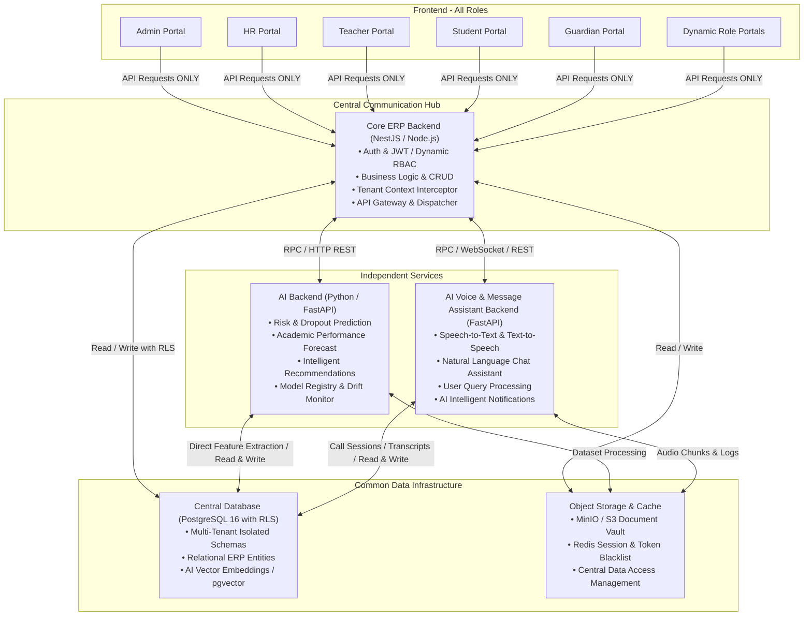
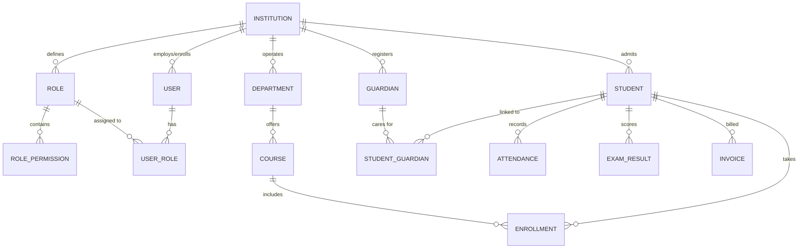

# সম্পূর্ণ ERP SaaS অ্যাডমিন প্যানেল অডিট এবং টেকনিক্যাল আর্কিটেকচার বিশ্লেষণ

> **ডকুমেন্টের ধরন (Document Type):** প্রোডাকশন রেডিনেস অডিট, সিস্টেম আর্কিটেকচার ও ইঞ্জিনিয়ারিং স্পেসিফিকেশন
> **সিস্টেমের নাম (System Name):** মডুলার এআই এবং ভয়েস ও মেসেজ অ্যাসিস্ট্যান্ট সমৃদ্ধ মাল্টি-টেন্যান্ট ERP SaaS প্ল্যাটফর্ম
> **পরীক্ষিত কোডবেস (Codebase Inspected):** `EDU-ADMIN-main` (Next.js 16 App Router Frontend)
> **অডিটের তারিখ (Audit Date):** নভেম্বর ২০২৬
> **অডিট স্ট্যাটাস (Audit Status):** সংশোধিত, আপডেটেড এবং আর্কিটেকচারাল ব্লুপ্রিন্ট সহ চূড়ান্ত

---

## নির্বাহী সারসংক্ষেপ (Executive Summary)

`EDU-ADMIN-main` কোডবেসের প্রতিটি ফাইল এবং ফোল্ডার ধরে একটি বিস্তারিত ও গভীর ইঞ্জিনিয়ারিং অডিট সম্পন্ন করা হয়েছে। বর্তমান রিপোজিটরিতে `src/app/admin/`-এর অধীনে **32টি প্রাতিষ্ঠানিক মডিউল (Institutional Modules)** রয়েছে, যার মধ্যে অন্তর্ভুক্ত রয়েছে **296টি React/JSX সোর্স ফাইল** এবং **35,169 লাইন ফ্রন্টএন্ড কোড**।

### প্রধান অডিট পর্যবেক্ষণ ও সিদ্ধান্ত (Key Audit Verdict):

1. **১০০% ইউআই প্রোটোটাইপ বাস্তবতা (100% UI Prototype Reality):** প্রতিটি মডিউল বর্তমানে সম্পূর্ণভাবে ক্লায়েন্ট-সাইড প্রেজেন্টেশন প্রোটোটাইপ হিসেবে কাজ করছে। সমগ্র ২৯৬টি অ্যাডমিনিস্ট্রেটিভ ফাইলের মধ্যে কোনো লাইভ API কল (`fetch` বা `axios`) নেই (**০ টি লাইভ API কল**)। সমস্ত ইন্টারঅ্যাক্টিভ উপাদান (টেবিল, চার্ট, মোডাল, ব্যাজ, কার্ড) শুধুমাত্র অস্থায়ী ইন-মেমোরি রিয়্যাক্ট `useState` অথবা স্ট্যাটিক মক কনস্ট্যান্ট থেকে ডেটা পড়ে এবং সেখানেই সংরক্ষণ করে।
2. **শূন্য অথেনটিকেশন ও উন্মুক্ত অ্যাডমিন অ্যাক্সেস (Zero Authentication & Open Administrative Access):** প্রজেক্টে কোনো `/login` বা অথেনটিকেশন রুট নেই। রুট রুট (`/`) এখনো ডিফল্ট Next.js টেমপ্লেট রয়ে গেছে। যেকোনো ভিজিটর সরাসরি ব্রাউজারে `http://localhost:3000/admin/...` এ প্রবেশ করলেই তাকে সম্পূর্ণ সুপার-অ্যাডমিন লেভেল অ্যাক্সেস দিয়ে দেওয়া হয়। কোনো রোল-ভিত্তিক গার্ড (RBAC Guards) বা মিডলওয়্যার বিদ্যমান নেই।
3. **রোল পোর্টাল ছাড়া একক অ্যাডমিন বান্ডেল (Monolithic Admin Bundling Without Role Portals):** বিভিন্ন রোল (সুপার অ্যাডমিন, ইনস্টিটিউট অ্যাডমিন, শিক্ষক, শিক্ষার্থী, অভিভাবক, এইচআর, স্টাফ)-এর জন্য আলাদা পোর্টালের প্রয়োজনীয়তা থাকা সত্ত্বেও, বিদ্যমান সমস্ত ফিচার একটিমাত্র একক `/admin` ডিরেক্টরিতে জড়ো করা হয়েছে। বর্তমান লেআউট (`AdminLayoutClient`) যেকোনো ইউজারের জন্য একটি সার্বজনীন সাইডবারে ৩২টি মডিউলের সবগুলোই প্রদর্শন করে।
4. **সার্বজনীন রোল ও ক্রেডেনশিয়াল ম্যান্ডেট (Universal Role Credential Mandate):** প্রতিটি রোলের—তা স্ট্যাটিক বিল্ট-ইন রোল হোক বা অ্যাডমিনের তৈরি ডায়নামিক রোল হোক—নিজস্ব ইউনিক ইউজারনেম এবং পাসওয়ার্ড থাকা বাধ্যতামূলক। বর্তমানে এই স্বয়ংক্রিয় ক্রেডেনশিয়াল জেনারেশন সিস্টেম সম্পূর্ণ অনুপস্থিত।
5. **শূন্য মাল্টি-টেন্যান্ট SaaS আইসোলেশন (Zero Multi-Tenant SaaS Isolation):** স্টেট, লোকাল স্টোরেজ, কুকিজ বা রুট প্যারামিটারে কোনো টেন্যান্ট কনটেক্সট (`tenant_id`, `institution_id`) বিদ্যমান নেই। কোনো সাবডোমেন রাউটিং মেকানিজম (`tenant.domain.com`) বা টেন্যান্ট ডেটাবেস আইসোলেশন স্কিমা নেই।
6. **গুরুত্বপূর্ণ লজিক্যাল ও UI ত্রুটি (Critical Logic & UI Deficiencies):** একাধিক ব্রোকেন লিংক (যা 404 ত্রুটি দেয়), অকার্যকর বা ডেড বাটন (`+ Add Student` বাটনে কোনো `onClick` নেই), সোর্স কোডের ভেতর প্লেইন-টেক্সট পাসওয়ার্ড হার্ডকোড করা থাকা, এবং এমন একটি ডায়নামিক রোল পারমিশন ম্যাট্রিক্স পাওয়া গেছে যা ৩২টির মধ্যে মাত্র ৫টি হার্ডকোডেড মডিউল ট্র্যাক করে।

---

## ১. সিস্টেম আর্কিটেকচার এবং ওয়ার্কফ্লো প্রসেস (System Architecture & Workflow Process)

### মডুলার এআই এবং ভয়েস ও মেসেজ অ্যাসিস্ট্যান্ট সমৃদ্ধ ERP সিস্টেম

সিস্টেমটি একটি আধুনিক, ডিকাপল্ড এবং মাল্টি-টায়ার এন্টারপ্রাইজ ইকোসিস্টেম হিসেবে ইঞ্জিনিয়ারিং করা হয়েছে যা কঠোর আর্কিটেকচারাল নীতি মেনে চলে:



### ১.১ ফ্রন্টএন্ড (Frontend - All Roles)

সিস্টেমের সমস্ত User Role-এর Frontend Code একটি নির্দিষ্ট ডিরেক্টরি কাঠামোর (`src/app/`) মধ্যে পরিচ্ছন্নভাবে বিন্যস্ত থাকবে:

- Admin (Super Admin & Institute Admin)
- HR & Payroll Staff
- Teacher & Faculty
- Student
- Guardian
- অন্যান্য ডায়নামিক ইউজার রোলসমূহ (যেমন: Exam Controller, Hostel Warden, Librarian)

**কঠোর নিয়ম (Strict Rule):** Frontend থেকে সরাসরি শুধুমাত্র **Core ERP Backend**-এর সাথে API Communication হবে। Frontend কখনো সরাসরি AI Backend, Voice Assistant Backend অথবা Shared Data Infrastructure-এর সাথে কানেক্ট হতে পারবে না।

### ১.২ কোর ইআরপি ব্যাকএন্ড (Core ERP Backend - Central Hub)

Core ERP Backend হবে পুরো এন্টারপ্রাইজ সিস্টেমের **Central Communication Hub**। এটি পরিচালনা করবে:

- মূল বিজনেস লজিক এবং ট্রানজেকশনাল ইন্টিগ্রিটি
- সেন্ট্রাল অথেনটিকেশন (JWT, MFA, সেশন ব্যবস্থাপনা)
- অথোরাইজেশন এবং ডায়নামিক RBAC (Role-Based Access Control)
- মাল্টি-টেন্যান্ট কনটেক্সট যাচাইকরণ ও প্রপাগেশন
- API ম্যানেজমেন্ট এবং অন্যান্য বিশেষায়িত ব্যাকএন্ড সার্ভিসের সাথে অর্কেস্ট্রেশন

Core ERP Backend তিনটি পৃথক উপাদানের সাথে সরাসরি সংযুক্ত থাকবে:

1. **AI Backend**
2. **AI Voice & Message Assistant Backend**
3. **Shared Data Infrastructure**

### ১.৩ এআই ব্যাকএন্ড (AI Backend)

একটি সম্পূর্ণ স্বাধীন এবং ইন্ডিপেন্ডেন্ট ব্যাকএন্ড সার্ভিস (Python / FastAPI) যেখানে AI/ML/DL-ভিত্তিক সমস্ত ফিচার ও প্রসেসিং লজিক থাকবে:

- শিক্ষার্থীদের একাডেমিক ঝুঁকি পূর্বাভাস (Student Academic Risk Prediction)
- পারফরম্যান্স পূর্বাভাস ও জিপিএ ট্র্যাজেক্টরি (Performance & GPA Prediction)
- ড্রপআউট ঝুঁকি শনাক্তকরণ (Dropout Risk Detection)
- বুদ্ধিবৃত্তিক সুপারিশ ও লার্নিং পাথ (Intelligent Recommendations)
- একাডেমিক ও ডিপার্টমেন্টাল ডেটা অ্যানালিটিক্স

**AI Backend-এর যোগাযোগের দুটি মাধ্যম:**

1. **Core ERP Backend**-এর সাথে রিকোয়েস্ট ও রেসপন্স আদান-প্রদান করবে।
2. **Shared Data Infrastructure**-এর সাথে সরাসরি **Read/Write** করবে (মডেল ফিচার এক্সট্রাকশন, ডেটাসেট প্রসেসিং, ভেক্টর এম্বেডিং সার্চ এবং প্রেডিকশন লগ সংরক্ষণের জন্য)।

### ১.৪ এআই ভয়েস ও মেসেজ অ্যাসিস্ট্যান্ট ব্যাকএন্ড (AI Voice & Message Assistant Backend)

রিয়েল-টাইম কথোপকথন ও বুদ্ধিবৃত্তিক যোগাযোগের জন্য সম্পূর্ণ আলাদা একটি ইন্ডিপেন্ডেন্ট ব্যাকএন্ড সার্ভিস (Python / FastAPI / WebSockets):

- রিয়েল-টাইম ভয়েস অ্যাসিস্ট্যান্ট এবং টেলিফোনি/SIP কল সেশন পরিচালনা
- টেক্সট-ভিত্তিক চ্যাট অ্যাসিস্ট্যান্ট (Text Chat Assistant)
- স্পিচ-টু-টেক্সট (STT) এবং টেক্সট-টু-স্পিচ (TTS)
- প্রাতিষ্ঠানিক তথ্য অনুসন্ধান প্রক্রিয়াকরণ (শিক্ষার্থী তথ্য, ফি স্ট্যাটাস, পরীক্ষার রুটিন)
- অভিযোগ ও আপত্তি গ্রহণ ও শ্রেণীবদ্ধকরণ (Complaint & Objection Classification)
- এআই-ভিত্তিক প্রাতিষ্ঠানিক বার্তা ও স্বয়ংক্রিয় নোটিফিকেশন প্রেরণ

**Voice & Message Assistant Backend-এর যোগাযোগের দুটি মাধ্যম:**

1. **Core ERP Backend**-এর সাথে API / WebSockets মাধ্যমে কমিউনিকেশন করবে।
2. **Shared Data Infrastructure**-এর সাথে সরাসরি **Read/Write** করবে (কল লগ, ট্রান্সক্রিপ্ট হিস্টোরি, চ্যাট সেশন স্টেট এবং ভেক্টর ডকুমেন্ট সংরক্ষণের জন্য)।

### ১.৫ শেয়ার্ড ডেটা ইনফ্রাস্ট্রাকচার (Shared Data Infrastructure)

Shared Data Infrastructure হবে পুরো সিস্টেমের কমন ডেটা লেয়ার (Common Data Layer):

- **সেন্ট্রাল ডেটাবেস (PostgreSQL 16):** রিলেশনাল ERP ডেটা, Row-Level Security (RLS) পলিসি এবং ভেক্টর ডেটাবেস (`pgvector`) ধারণ করবে।
- **ডেটা স্টোরেজ:** শিক্ষার্থী ও একাডেমিক ডকুমেন্টস, ভয়েস কল রেকর্ডিং ও সনদের জন্য S3 / MinIO অবজেক্ট স্টোরেজ।
- **শেয়ার্ড ডেটা সার্ভিস ও ক্যাশ:** সেশন ব্ল্যাকলিস্টিং, রেট লিমিটিং ও টেন্যান্ট রেজোলিউশনের জন্য Redis।
- **ডেটা অ্যাক্সেস ম্যানেজমেন্ট:** কেন্দ্রীয় অ্যাক্সেস পলিসি যা তিনটি ব্যাকএন্ডের মধ্যে টেন্যান্ট আইসোলেশন ও ডেটা ধারাবাহিকতা (Data Consistency) বজায় রাখবে।

### ১.৬ সম্পূর্ণ সিস্টেমের কার্যপ্রবাহ (Complete System Workflow)

1. **Step 1:** User Frontend থেকে কোনো রিকোয়েস্ট পাঠাবে।
2. **Step 2:** Frontend রিকোয়েস্ট **শুধুমাত্র Core ERP Backend**-এ পাঠাবে।
3. **Step 3:** Core ERP Backend টেন্যান্ট কনটেক্সট যাচাই করবে এবং রিকোয়েস্টের ধরন অনুযায়ী প্রয়োজনীয় বিজনেস লজিক এক্সিকিউট করবে।
4. **Step 4:** যদি AI-ভিত্তিক কোনো কাজের প্রয়োজন হয় (যেমন: ড্রপআউট প্রেডিকশন, কোর্স রেকমেন্ডেশন), Core ERP Backend **AI Backend**-এর সাথে যোগাযোগ করবে।
5. **Step 5:** যদি ভয়েস বা মেসেজ অ্যাসিস্ট্যান্টের প্রয়োজন হয়, Core ERP Backend **Voice & Message Assistant Backend**-এর সাথে যোগাযোগ করবে।
6. **Step 6:** প্রয়োজন অনুযায়ী Core ERP Backend, AI Backend এবং Voice & Message Assistant Backend প্রত্যেকে সরাসরি **Shared Data Infrastructure** থেকে প্রয়োজনীয় ডেটা Access (Read/Write) করবে।
7. **Step 7:** সংশ্লিষ্ট ব্যাকএন্ড প্রসেসিং সম্পন্ন করে রেজাল্ট Core ERP Backend-এ রিটার্ন করবে।
8. **Step 8:** Core ERP Backend ফাইনাল রেসপন্স তৈরি করে Frontend-এ পাঠাবে এবং Frontend ইউজারকে রেজাল্ট প্রদর্শন করবে।

### ১.৭ গুরুত্বপূর্ণ আর্কিটেকচারাল নিয়মাবলী (Important Architectural Rules)

1. **Frontend can communicate ONLY with Core ERP Backend.**
2. **Core ERP Backend acts as the Central Communication Hub.**
3. **AI Backend must remain a separate and independent service.**
4. **Voice & Message Assistant Backend must remain a separate and independent service.**
5. **All three Backend Services must have direct connections to Shared Data Infrastructure.**
6. **No direct Frontend-to-AI, Frontend-to-Voice or Frontend-to-Database connection is allowed.**
7. **Each Backend must maintain its own independent codebase and responsibilities.**

---

## ২. বিদ্যমান কোডবেস অডিট (৩২টি অ্যাডমিন মডিউল) (Folder-by-Folder Code Audit)

`src/app/admin/`-এর পুঙ্খানুপুঙ্খ স্ক্যানে দেখা গেছে মোট 32টি মডিউলের ভেতর 296টি ফাইল এবং 35,169 লাইন ফ্রন্টএন্ড কোড রয়েছে।


| #  | মডিউল ফোল্ডার | সাবরুট সংখ্যা | মোট ফাইল | কোড লাইন | লাইভ ফেচ (Live Fetch) | ইন্টারঅ্যাক্টিভ উপাদান  | মক স্টেট ভেরিয়েবলসমূহ                 |
| ---- | --------------------------- | --------------------------- | ----------------- | ----------------- | ------------------------------ | ---------------------------------------------- | ---------------------------------------------------------- |
| 1  | `ai-analytics`            | 10                        | 14              | 997             | না (০)                    | বাটন: 5, ইনপুট: 3, টেবিল: 1    | `Inline Objects`                                         |
| 2  | `api`                     | 10                        | 13              | 745             | না (০)                    | বাটন: 10, ইনপুট: 5, টেবিল: 1   | `Inline Objects`                                         |
| 3  | `application`             | 8                         | 9               | 1,228           | না (০)                    | বাটন: 40, ইনপুট: 24, টেবিল: 9  | `initialApplications, initialApprovals, initialCards`    |
| 4  | `attendance`              | 1                         | 1               | 304             | না (০)                    | বাটন: 2, ইনপুট: 0, টেবিল: 1    | `mockStudents`                                           |
| 5  | `certificate`             | 4                         | 7               | 854             | না (০)                    | বাটন: 3, ইনপুট: 3, টেবিল: 2    | `Inline Objects`                                         |
| 6  | `classroom`               | 6                         | 7               | 1,949           | না (০)                    | বাটন: 45, ইনপুট: 17, টেবিল: 3  | `mockCourses, mockDiscussions, mockQueries`              |
| 7  | `document`                | 5                         | 8               | 951             | না (০)                    | বাটন: 3, ইনপুট: 3, টেবিল: 2    | `Inline Objects`                                         |
| 8  | `examination`             | 9                         | 10              | 2,670           | না (০)                    | বাটন: 50, ইনপুট: 29, টেবিল: 10 | `mockCourses, mockHalls, mockImprovementApps`            |
| 9  | `finance`                 | 5                         | 6               | 1,872           | না (০)                    | বাটন: 44, ইনপুট: 53, টেবিল: 9  | `initialInvoices, initialPayments, mockTransactions`     |
| 10 | `guardian`                | 4                         | 4               | 424             | না (০)                    | বাটন: 16, ইনপুট: 4, টেবিল: 1   | `mockCredentials, mockData, mockGuardians`               |
| 11 | `hostel`                  | 6                         | 9               | 838             | না (০)                    | বাটন: 3, ইনপুট: 3, টেবিল: 1    | `Inline Objects`                                         |
| 12 | `hr`                      | 7                         | 10              | 936             | না (০)                    | বাটন: 3, ইনপুট: 2, টেবিল: 1    | `Inline Objects`                                         |
| 13 | `import-export`           | 7                         | 10              | 1,045           | না (০)                    | বাটন: 6, ইনপুট: 5, টেবিল: 2    | `Inline Objects`                                         |
| 14 | `institution`             | 7                         | 7               | 379             | না (০)                    | বাটন: 6, ইনপুট: 3, টেবিল: 1    | `Inline Objects`                                         |
| 15 | `inventory`               | 6                         | 9               | 921             | না (০)                    | বাটন: 3, ইনপুট: 3, টেবিল: 1    | `Inline Objects`                                         |
| 16 | `library`                 | 6                         | 7               | 1,170           | না (০)                    | বাটন: 31, ইনপুট: 25, টেবিল: 5  | `mockBooks, mockDocuments, mockEbooks`                   |
| 17 | `lms`                     | 8                         | 9               | 3,244           | না (০)                    | বাটন: 69, ইনপুট: 58, টেবিল: 5  | `mockAssignments, mockCodingTasks, mockGeneratedQuizzes` |
| 18 | `monitoring`              | 9                         | 12              | 767             | না (০)                    | বাটন: 5, ইনপুট: 2, টেবিল: 1    | `Inline Objects`                                         |
| 19 | `notice`                  | 6                         | 9               | 742             | না (০)                    | বাটন: 3, ইনপুট: 3, টেবিল: 2    | `Inline Objects`                                         |
| 20 | `notification`            | 8                         | 11              | 1,263           | না (০)                    | বাটন: 8, ইনপুট: 9, টেবিল: 1    | `Inline Objects`                                         |
| 21 | `objection`               | 7                         | 10              | 504             | না (০)                    | বাটন: 7, ইনপুট: 4, টেবিল: 1    | `Inline Objects`                                         |
| 22 | `reports`                 | 11                        | 14              | 1,188           | না (০)                    | বাটন: 8, ইনপুট: 6, টেবিল: 1    | `Inline Objects`                                         |
| 23 | `research`                | 6                         | 9               | 998             | না (০)                    | বাটন: 3, ইনপুট: 2, টেবিল: 1    | `Inline Objects`                                         |
| 24 | `scholarship`             | 6                         | 7               | 2,209           | না (০)                    | বাটন: 26, ইনপুট: 24, টেবিল: 6  | `initialApplications, initialApprovals, initialCriteria` |
| 25 | `settings`                | 13                        | 17              | 973             | না (০)                    | বাটন: 2, ইনপুট: 6, টেবিল: 0    | `Inline Objects`                                         |
| 26 | `student`                 | 3                         | 3               | 354             | না (০)                    | বাটন: 8, ইনপুট: 2, টেবিল: 0    | `mockStudents`                                           |
| 27 | `system`                  | 4                         | 9               | 1,682           | না (০)                    | বাটন: 27, ইনপুট: 47, টেবিল: 3  | `initialRoles, initialUsers`                             |
| 28 | `teacher`                 | 3                         | 3               | 394             | না (০)                    | বাটন: 5, ইনপুট: 1, টেবিল: 2    | `mockEvaluations, mockTeachers, mockWorkload`            |
| 29 | `transport`               | 6                         | 9               | 899             | না (০)                    | বাটন: 3, ইনপুট: 3, টেবিল: 1    | `Inline Objects`                                         |
| 30 | `voice-ai`                | 20                        | 24              | 1,058           | না (০)                    | বাটন: 9, ইনপুট: 3, টেবিল: 2    | `Inline Objects`                                         |
| 31 | `voting`                  | 6                         | 9               | 797             | না (০)                    | বাটন: 3, ইনপুট: 2, টেবিল: 1    | `Inline Objects`                                         |
| 32 | `workflow`                | 7                         | 10              | 814             | না (০)                    | বাটন: 5, ইনপুট: 2, টেবিল: 1    | `Inline Objects`                                         |

---

## ৩. ফিচার-অনুযায়ী কার্যকারিতা মূল্যায়ন (Feature-by-Feature Assessment)


| ERP ফিচার গ্রুপ                                            | নির্দিষ্ট মডিউল | স্ট্যাটাস                        | UI স্ট্যাটাস                                               | ডেটা পারসিস্টেন্স | প্রয়োজনীয় ব্যাকএন্ড সার্ভিস |
| ---------------------------------------------------------------------- | ------------------------------- | ------------------------------------------- | --------------------------------------------------------------------- | ----------------------------------- | ------------------------------------------------------ |
| **কোর একাডেমিক (Core Academics)**                         | Student Information           | আংশিক (Partial)                      | UI কাজ করে, '+ Add' বাটন অকার্যকর                 | কোনোটিই নয় (In-memory)   | `StudentService.createStudent`                       |
|                                                                      | Student Analytics             | কার্যকরী প্রোটোটাইপ     | মেট্রিক্স ও চার্ট কাজ করে                      | কোনোটিই নয় (Static)      | `AnalyticsService.getStudentKPIs`                    |
|                                                                      | ID Management                 | কার্যকরী প্রোটোটাইপ     | কার্ড প্রিভিউ কাজ করে                             | কোনোটিই নয় (Static)      | `IDCardService.generateBarcode`                      |
|                                                                      | Teacher Directory             | কার্যকরী প্রোটোটাইপ     | ফিল্টারেবল শিক্ষক তালিকা                      | কোনোটিই নয় (Static)      | `TeacherService.findAll`                             |
|                                                                      | Classroom Management          | কার্যকরী প্রোটোটাইপ     | শিডিউল ও রুম বরাদ্দ                                 | কোনোটিই নয় (Static)      | `ClassroomService.allocateRoom`                      |
| **ভর্তি ও রেজিস্ট্রেশন (Enrollment & Admissions)** | Applications                  | কার্যকরী প্রোটোটাইপ     | মাল্টি-স্টেপ রিভিউ ট্যাব                       | কোনোটিই নয় (Static)      | `AdmissionService.processApplication`                |
|                                                                      | Objection Handling            | কার্যকরী প্রোটোটাইপ     | স্ট্যাটাস ট্র্যাকিং ব্যাজ                    | কোনোটিই নয় (Static)      | `ObjectionService.updateStatus`                      |
| **উপস্থিতি ও পরীক্ষা (Attendance & Exams)**          | Attendance Records            | কার্যকরী প্রোটোটাইপ     | ক্লাস উপস্থিতি ম্যাট্রিক্স                  | কোনোটিই নয় (Static)      | `AttendanceService.recordBulk`                       |
|                                                                      | Examination Setup             | কার্যকরী প্রোটোটাইপ     | পরীক্ষার রুটিন ও গ্রেডবুক                     | কোনোটিই নয় (Static)      | `ExamService.publishResults`                         |
|                                                                      | Certificate Generation        | কার্যকরী প্রোটোটাইপ     | PDF লেআউট টেমপ্লেট                                     | কোনোটিই নয় (Static)      | `CertificateService.renderPDF`                       |
| **অর্থ ও বিলিং (Finance & Billing)**                       | Fee Structure                 | কার্যকরী প্রোটোটাইপ     | ফি হেড বিভাজন                                            | কোনোটিই নয় (Static)      | `FinanceService.createFeeHead`                       |
|                                                                      | Invoices & Payments           | কার্যকরী প্রোটোটাইপ     | চালান তালিকা ও ফি কালেকশন                      | কোনোটিই নয় (Static)      | `PaymentService.createInvoice`                       |
|                                                                      | Transactions                  | কার্যকরী প্রোটোটাইপ     | অডিট লেজার তালিকা                                    | কোনোটিই নয় (Static)      | `TransactionService.getLedger`                       |
| **এইচআর ও অপারেশন (HR & Operations)**                   | HR Directory & Payroll        | কার্যকরী প্রোটোটাইপ     | স্টাফ ডিরেক্টরি ও বেতন বিবরণী              | কোনোটিই নয় (Static)      | `HRService.processPayroll`                           |
|                                                                      | Inventory & Assets            | কার্যকরী প্রোটোটাইপ     | স্টক ট্র্যাকিং ও সরবরাহকারী তালিকা    | কোনোটিই নয় (Static)      | `InventoryService.adjustStock`                       |
|                                                                      | Hostel Management             | কার্যকরী প্রোটোটাইপ     | রুম বরাদ্দ ও সিট গণনা                              | কোনোটিই নয় (Static)      | `HostelService.allocateBed`                          |
|                                                                      | Transport Routes              | কার্যকরী প্রোটোটাইপ     | যানবাহন ও বাস রুট টেবিল                          | কোনোটিই নয় (Static)      | `TransportService.assignRoute`                       |
| **লাইব্রেরি ও এলএমএস (Library & LMS)**               | Library Catalog               | কার্যকরী প্রোটোটাইপ     | ইস্যু/রিটার্ন লগ ও বই অনুসন্ধান           | কোনোটিই নয় (Static)      | `LibraryService.issueBook`                           |
|                                                                      | LMS Courses                   | কার্যকরী প্রোটোটাইপ     | সিলেবাস, অ্যাসাইনমেন্ট, লেসন                | কোনোটিই নয় (Static)      | `LMSService.createCourse`                            |
| **প্রশাসন ও পরিচালনা (Governance & Admin)**          | System Role Permission        | ব্রোকেন / আংশিক               | মাত্র ৫টি মডিউল; রিলোডে ডেটা মুছে যায় | কোনোটিই নয় (Static)      | `RBACService.updateRolePermissions`                  |
|                                                                      | Guardian Portal Access        | ঝুঁকিপূর্ণ প্রোটোটাইপ | প্লেইন-টেক্সট পাসওয়ার্ড হার্ডকোডেড   | কোনোটিই নয় (Static)      | `AuthService.generateCredentials`                    |
|                                                                      | Institution Settings          | কার্যকরী প্রোটোটাইপ     | ক্যাম্পাস প্রোফাইল ও সেটিংস                 | কোনোটিই নয় (Static)      | `TenantService.updateTenantProfile`                  |
|                                                                      | Security Settings             | ব্রোকেন (সাইডবারে 404)     | রুট অমিল (Route Mismatch)                                    | কোনোটিই নয়               | `SecurityService.getMFAConfig`                       |
|                                                                      | Research Features             | ব্রোকেন (সাইডবারে 404)     | রুট অমিল (Route Mismatch)                                    | কোনোটিই নয়               | `ResearchService.getGrants`                          |

---

## ৪. চিহ্নিত বাগ, প্রযুক্তিগত সমস্যা এবং ইঞ্জিনিয়ারিং সমাধান (Bugs & Engineering Solutions)

একজন সফটওয়্যার ইঞ্জিনিয়ার হিসেবে প্রতিটি ত্রুটির সুনির্দিষ্ট কারণ এবং সমাধানের ব্লুপ্রিন্ট নিচে পেশ করা হলো:

### ৪.১ ডেড রুট ও 404 লিংক — কারণ ও ইঞ্জিনিয়ারিং সমাধান

1. **ত্রুটি: অনুপস্থিত Security পেজের সাইডবার লিংক (`/admin/security` → 404)**
   - *মূল কারণ:* `src/lib/moduleData.jsx` ফাইলে `/admin/security` দেওয়া হয়েছে, কিন্তু পেজটি মূলত `src/app/admin/settings/security/page.jsx` এ রয়েছে।
   - *ইঞ্জিনিয়ারিং সমাধান:* `src/lib/moduleData.jsx`-এ লিংকটি সংশোধন করে `/admin/settings/security` করা হবে এবং অতিরিক্ত সতর্কতা হিসেবে `next.config.js`-এ একটি রিরাইট রুল যুক্ত করে `/admin/security` কে `/admin/settings/security`-তে রিডাইরেক্ট করা হবে।
2. **ত্রুটি: Research Features সাইডবার ও ইন-মডিউল লিংক (`/admin/research/features` → 404)**
   - *মূল কারণ:* `moduleData.jsx` এবং `ResearchList.jsx` উভয় ফাইলে লিংকটি `/admin/research/features` দেওয়া, যার কোনো সাবফোল্ডার নেই।
   - *ইঞ্জিনিয়ারিং সমাধান:* উভয় ফাইলের টার্গেট লিংক পরিবর্তন করে মূল রিসার্চ ড্যাশবোর্ড `/admin/research` এ পয়েন্ট করা।
3. **ত্রুটি: Voting মডিউলে ইন্টারনাল ডেড লিংক (`/admin/voting/features` → 404)**
   - *মূল কারণ:* `VotingList.jsx` এর বাটন লিংক `/admin/voting/features` করা।
   - *ইঞ্জিনিয়ারিং সমাধান:* লিংক পরিবর্তন করে মূল `/admin/voting` এ পয়েন্ট করা।

### ৪.২ অকার্যকর বাটনসমূহ — কারণ ও ইঞ্জিনিয়ারিং সমাধান

1. **ত্রুটি: `+ Add Student` ডেড বাটন (`src/app/admin/student/information/page.jsx`)**
   - *মূল কারণ:* বাটনটিতে কোনো `onClick` ইভেন্ট হ্যান্ডলার নেই।
   - *ইঞ্জিনিয়ারিং সমাধান:* বাটনটির সাথে `AddStudentModal` কম্পোনেন্ট বাইন্ড করা হবে যা `react-hook-form` এবং `zod` স্কিমা দ্বারা ভ্যালিডেটেড হবে। ফর্ম সাবমিট হলে Core ERP Backend-এর `POST /api/v1/admissions/enroll` এ কল যাবে, যা স্বয়ংক্রিয়ভাবে শিক্ষার্থীর ইউজারনেম/পাসওয়ার্ড এবং অভিভাবকের ইউজারনেম/পাসওয়ার্ড জেনারেট করে SMS ও ইমেইলে পাঠিয়ে দেবে।
2. **ত্রুটি: `Send Credentials` ডেড বাটন (`src/app/admin/guardian/portal-access/page.jsx`)**
   - *মূল কারণ:* বাটনে কোনো API কল নেই।
   - *ইঞ্জিনিয়ারিং সমাধান:* বাটনটি ব্যাকএন্ডের `POST /api/v1/auth/dispatch-credentials` এন্ডপয়েন্টের সাথে যুক্ত হবে।

### ৪.৩ গুরুতর নিরাপত্তা ও ডেটা ইন্টিগ্রিটি ত্রুটি — কারণ ও ইঞ্জিনিয়ারিং সমাধান

1. **ত্রুটি: ক্লায়েন্ট সোর্স কোডে প্লেইন-টেক্সট পাসওয়ার্ড হার্ডকোড থাকা**
   - *অবস্থান:* `src/app/admin/guardian/portal-access/page.jsx` (`password: 'pass@1234'`)
   - *ইঞ্জিনিয়ারিং সমাধান:* ক্লায়েন্টে কোনো পাসওয়ার্ড পাঠানো বা দেখানো যাবে না। API শুধুমাত্র `status: 'ACTIVE'`, `credentials_dispatched_at: timestamp` রিটার্ন করবে। পাসওয়ার্ড শুধুমাত্র Core ERP Backend-এ তৈরি হবে এবং Argon2id দ্বারা হ্যাশ হয়ে PostgreSQL ডেটাবেসে সংরক্ষিত থাকবে।
2. **ত্রুটি: অসম্পূর্ণ মাস্টার পারমিশন ম্যাট্রিক্স (৩২টির মধ্যে মাত্র ৫টি মডিউল থাকা)**
   - *অবস্থান:* `src/app/admin/system/role-permission/page.jsx`
   - *ইঞ্জিনিয়ারিং সমাধান:* পারমিশন ম্যানেজারটি ডায়নামিকভাবে `GET /api/v1/system/modules` থেকে সমস্ত ৩২টি প্রাতিষ্ঠানিক মডিউল লোড করবে। প্রতিটি মডিউলে ৬টি গ্র্যানুলার অ্যাকশন (`create`, `read`, `update`, `delete`, `export`, `approve`) এবং ৩টি স্কোপ (`all`, `department`, `assigned_only`) থাকবে, যা ডেটাবেসে স্থায়ীভাবে সেভ হবে।
3. **ত্রুটি: কোনো অথেনটিকেশন ও অ্যাক্সেস গার্ড না থাকা**
   - *ইঞ্জিনিয়ারিং সমাধান:* `src/middleware.js` তৈরি করে সমস্ত রুট সুরক্ষিত করা হবে। অথেনটিকেশন ছাড়া প্রবেশ করলে সরাসরি `/login` পেজে রিডাইরেক্ট হবে।

---

## ৫. অনুপস্থিত ERP মডিউল ও প্রাতিষ্ঠানিক ওয়ার্কফ্লো

### ৫.১ শিক্ষার্থী ভর্তি ও স্বয়ংক্রিয় ইউজার তৈরির সম্পূর্ণ ওয়ার্কফ্লো

1. **অনলাইন আবেদন:** শিক্ষার্থী প্রয়োজনীয় সকল তথ্য ও সনদ আপলোড করবে।
2. **যাচাই ও অনুমোদন:** অ্যাডমিন তথ্য যাচাই করে অনুমোদন দেবেন ও রেজিস্ট্রেশন নম্বর নির্ধারণ করবেন।
3. **ভর্তি ফি পরিশোধ:** পেমেন্ট গেটওয়ের মাধ্যমে প্রাথমিক ফি ক্লিয়ারেন্স সম্পন্ন হবে।
4. **স্বয়ংক্রিয় ক্রেডেনশিয়াল জেনারেশন পাইপলাইন:**
   - সিস্টেম স্বয়ংক্রিয়ভাবে শিক্ষার্থীর জন্য ইউনিক ইউজারনেম ও ক্রিপ্টোগ্রাফিক পাসওয়ার্ড তৈরি করবে।
   - সিস্টেম স্বয়ংক্রিয়ভাবে অভিভাবকের জন্য ইউনিক ইউজারনেম ও ক্রিপ্টোগ্রাফিক পাসওয়ার্ড তৈরি করবে।
   - উভয় অ্যাকাউন্টেই `must_change_password = true` ফ্ল্যাগ থাকবে এবং SMS ও ইমেইলের মাধ্যমে তৎক্ষণাৎ ক্রেডেনশিয়াল পাঠিয়ে দেওয়া হবে।

### ৫.২ একাডেমিক রুটিন ও কনফ্লিক্ট ডিটেকশন ইঞ্জিন

- একই সময় স্লটে একই শিক্ষক, ক্লাসরুম বা সেকশনে একাধিক ক্লাসের কনফ্লিক্ট স্বয়ংক্রিয়ভাবে শনাক্ত ও ব্লক করা।

### ৫.৩ গ্রেডিং ও পরীক্ষা ফলাফল প্রকাশনা ইঞ্জিন

- জিপিএ ক্যালকুলেশন, গ্রেডিং স্কেল এবং ভেরিফিকেশন QR কোড সহ অফিসিয়াল ট্রান্সক্রিপ্ট PDF তৈরি।

### ৫.৪ প্রাতিষ্ঠানিক ডাবল-এন্ট্রি অ্যাকাউন্টিং ও ফি লেজার

- খাতভিত্তিক ফি কালেকশন, স্কলারশিপ সমন্বয় এবং স্বয়ংক্রিয় ব্যাংক রিকনসিলিয়েশন।

---

## ৬. রোল-ভিত্তিক পোর্টাল এবং ডায়নামিক পারমিশন ব্যবস্থাপনা

### ৬.১ প্রতিটি রোলের জন্য স্বতন্ত্র ইউজারনেম ও পাসওয়ার্ড ম্যান্ডেট

**অত্যন্ত গুরুত্বপূর্ণ আর্কিটেকচারাল নীতি:** সিস্টেমের প্রতিটি রোলের জন্য—তা প্রি-ডিফাইনড স্ট্যান্ডার্ড রোল হোক বা অ্যাডমিন কর্তৃক তৈরি করা কোনো ডায়নামিক রোল হোক—**প্রত্যেকটি রোলের অধীনে নিজস্ব ইউনিক ইউজার অ্যাকাউন্ট, ইউজারনেম এবং পাসওয়ার্ড তৈরি হতে হবে**।

1. **স্ট্যান্ডার্ড প্রাতিষ্ঠানিক রোলসমূহ:**

   - **Super Admin:** প্ল্যাটফর্ম ম্যানেজমেন্ট ও টেন্যান্ট প্রভিশনিং।
   - **Institute Admin:** শিক্ষা প্রতিষ্ঠানের সার্বিক কার্যক্রম নিয়ন্ত্রণ।
   - **Teacher / Faculty:** শিক্ষক পোর্টাল (উপস্থিতি, মার্কস এন্ট্রি, এলএমএস)।
   - **Student:** শিক্ষার্থী পোর্টাল (কোর্স, ফলাফল, ফি পরিশোধ, আইডি কার্ড)।
   - **Guardian:** অভিভাবক পোর্টাল (সন্তানের উপস্থিতি, রিপোর্ট কার্ড, টিউশন ফি প্রদান)।
   - **HR / Payroll Staff:** কর্মী নিয়োগ, হাজিরা, বেতন প্রদান।
   - **Accountant:** ভাউচার এন্ট্রি, লেজার ও আর্থিক বিবরণী।
2. **ডায়নামিক রোলসমূহ (অ্যাডমিন কর্তৃক রানটাইমে তৈরি):**

   - ইনস্টিটিউট অ্যাডমিন প্রয়োজন অনুযায়ী যেকোনো সময় নতুন প্রাতিষ্ঠানিক রোল তৈরি করতে পারবেন, যেমন:
     - `সহকারী পরীক্ষা নিয়ন্ত্রক (Assistant Exam Controller)`
     - `হোস্টেল সুপার / ওয়ার্ডেন (Hostel Warden)`
     - `পরিবহন সমন্বয়কারী (Transport Coordinator)`
     - `বিভাগীয় প্রধান (Head of Department)`
     - `ভর্তি কর্মকর্তা (Admissions Officer)`
     - `প্রধান গ্রন্থাগারিক (Senior Librarian)`
   - **ডায়নামিক রোলের স্বয়ংক্রিয় ইউজারনেম ও পাসওয়ার্ড তৈরি:** যখনই কোনো ডায়নামিক রোল তৈরি করে কোনো কর্মীকে অ্যাসাইন করা হবে:
     - সিস্টেম **স্বয়ংক্রিয়ভাবে একটি ইউনিক ইউজারনেম তৈরি করবে** (যেমন: `staff.<role_slug>.<firstname>` বা অনুরূপ ফরম্যাট)।
     - সিস্টেম **একটি নিরাপদ ও শক্তিশালী অস্থায়ী পাসওয়ার্ড তৈরি করবে**।
     - `users` টেবিলে ওই `role_id` এর সাথে ম্যাপ করে ইউজার রেকর্ড তৈরি হবে।
     - ইউজারনেম ও পাসওয়ার্ড স্বয়ংক্রিয়ভাবে সংশ্লিষ্ট ইউজারের SMS ও ইমেইলে পাঠিয়ে দেওয়া হবে।
     - অ্যাকাউন্টে `must_change_password = true` সেট থাকবে।
     - ওই ইউজার সিস্টেমে লগইন করার পর ডায়নামিক রোলে অ্যাডমিন যেসব মডিউলের অনুমোদন দিয়েছেন কেবল সেই ফিচারগুলো দেখতে ও ব্যবহার করতে পারবে।

### ৬.২ প্রস্তাবিত মাল্টি-পোর্টাল ফোল্ডার আর্কিটেকচার

```
src/app/
├── (auth)/
│   ├── login/page.jsx              <-- সব রোলের জন্য সেন্ট্রাল লগইন (ইউজারনেম + পাসওয়ার্ড + MFA)
│   ├── forgot-password/page.jsx
│   └── reset-password/page.jsx
├── (admin)/admin/                  <-- সুপার অ্যাডমিন ও ইনস্টিটিউট অ্যাডমিন কন্ট্রোল সেন্টার
├── (teacher)/portal/teacher/       <-- ডেডিকেটেড শিক্ষক পোর্টাল
├── (student)/portal/student/       <-- ডেডিকেটেড শিক্ষার্থী পোর্টাল
├── (guardian)/portal/guardian/     <-- ডেডিকেটেড অভিভাবক পোর্টাল
├── (hr)/portal/hr/                 <-- ডেডিকেটেড এইচআর পোর্টাল
└── (staff)/portal/staff/           <-- ডায়নামিক রোল পোর্টাল (পারমিশনের ভিত্তিতে ডাইনামিক UI)
```

### ৬.৩ ডায়নামিক রোল ও পারমিশন ডেটা স্পেসিফিকেশন

```typescript
export type PermissionAction = 'create' | 'read' | 'update' | 'delete' | 'export' | 'approve';
export type PermissionScope = 'all' | 'department' | 'assigned_only';

export interface ModulePermission {
  moduleId: string; // যেমন: 'finance', 'attendance', 'students', 'examination'
  actions: PermissionAction[]; // ['read', 'create', 'update']
  scope: PermissionScope;
}

export interface DynamicRole {
  id: string;
  tenantId: string;
  name: string; // যেমন: 'সহকারী পরীক্ষা নিয়ন্ত্রক'
  portalType: 'ADMIN' | 'TEACHER' | 'STUDENT' | 'GUARDIAN' | 'STAFF';
  isSystemRole: boolean; // বিল্ট-ইন সিস্টেম রোল ডিলিট হওয়া রোধ করে
  permissions: ModulePermission[];
}

export interface ProvisionedUserCredentials {
  userId: string;
  tenantId: string;
  roleId: string;
  username: string; // যেমন: 'staff.examcontroller.kamal'
  temporaryPasswordHash: string;
  mustChangePasswordOnFirstLogin: boolean; // ডিফল্ট: true
  dispatchedVia: 'SMS' | 'EMAIL' | 'BOTH';
}
```

---

## ৭. SaaS এবং মাল্টি-টেন্যান্ট আর্কিটেকচার প্রস্তুতি

### ৭.১ মাল্টি-টেন্যান্সি বাস্তবায়ন কৌশল

1. **টেন্যান্ট শনাক্তকরণ:** সাবডোমেন (`https://dhaka-college.eduerp.com`) এবং কাস্টম ডোমেন (`https://erp.dhakacollege.edu.bd`)।
2. **মিডলওয়্যার কনটেক্সট প্রপাগেশন:** `src/middleware.js` আগত হোস্টনেম থেকে `tenant_id` বের করে ব্যাকএন্ড রিকোয়েস্টে `x-tenant-id` হেডার যুক্ত করবে।
3. **ডেটাবেস ডেটা আইসোলেশন:** প্রতিটি টেবিলে `tenant_id UUID` কলাম এবং PostgreSQL Row-Level Security (RLS) পলিসি বলবৎ থাকবে।

---

## ৮. প্রয়োজনীয় ফ্রন্টএন্ড উন্নয়ন ও সংস্কার

1. **ফর্ম ভ্যালিডেশন:** সমস্ত ইনপুটের জন্য `react-hook-form` এবং `zod` স্কিমা ভ্যালিডেশন বাধ্যতামূলক করা।
2. **কেন্দ্রীভূত API ক্লায়েন্ট:** `src/lib/apiClient.js` এ সেন্ট্রালাইজড Axios ইন্সট্যান্স (স্বয়ংক্রিয় JWT, Tenant ID ও টোকেন রিফ্রেশ হ্যান্ডলার সহ)।
3. **সার্ভার স্টেট ম্যানেজমেন্ট:** `@tanstack/react-query` ব্যবহার করে ক্যাশিং ও অপটিমিস্টিক আপডেট নিশ্চিত করা।
4. **স্কেলেটন লোডার ও রেসপন্সিভ টেবিল:** নেটওয়ার্ক কলের সময় স্মুথ অ্যানিমেটেড স্কেলেটন প্রদর্শন।
5. **ডায়নামিক সাইডবার ফিল্টারিং:** ইউজারের লগইন করা রোল ও পারমিশন অনুযায়ী সাইডবার মডিউল ফিল্টার করা।

---

## ৯. ব্যাকএন্ড API এবং ডেটাবেস প্রয়োজনীয়তা

### ৯.১ ডেটাবেস রিলেশন ডায়াগ্রাম (PostgreSQL)



### ৯.২ মূল PostgreSQL DDL স্কিমাসমূহ

```sql
-- ১. টেন্যান্ট / শিক্ষা প্রতিষ্ঠান
CREATE TABLE institutions (
    id UUID PRIMARY KEY DEFAULT gen_random_uuid(),
    slug VARCHAR(50) UNIQUE NOT NULL,
    name VARCHAR(255) NOT NULL,
    domain VARCHAR(255) UNIQUE,
    currency VARCHAR(10) DEFAULT 'BDT',
    status VARCHAR(20) DEFAULT 'ACTIVE',
    created_at TIMESTAMP WITH TIME ZONE DEFAULT NOW()
);

-- ২. ইউজার টেবিল (স্ট্যান্ডার্ড ও ডায়নামিক উভয় রোলের ইউজারদের জন্য)
CREATE TABLE users (
    id UUID PRIMARY KEY DEFAULT gen_random_uuid(),
    institution_id UUID NOT NULL REFERENCES institutions(id) ON DELETE CASCADE,
    username VARCHAR(100) NOT NULL,
    email VARCHAR(255),
    phone VARCHAR(30),
    password_hash VARCHAR(255) NOT NULL,
    user_type VARCHAR(20) NOT NULL, -- 'ADMIN', 'TEACHER', 'STUDENT', 'GUARDIAN', 'STAFF'
    is_active BOOLEAN DEFAULT TRUE,
    must_change_password BOOLEAN DEFAULT TRUE,
    created_at TIMESTAMP WITH TIME ZONE DEFAULT NOW(),
    CONSTRAINT uk_user_institution_username UNIQUE(institution_id, username)
);

-- ৩. ডায়নামিক রোল ও পারমিশন টেবিল
CREATE TABLE roles (
    id UUID PRIMARY KEY DEFAULT gen_random_uuid(),
    institution_id UUID NOT NULL REFERENCES institutions(id) ON DELETE CASCADE,
    name VARCHAR(100) NOT NULL,
    portal_type VARCHAR(20) NOT NULL,
    is_system BOOLEAN DEFAULT FALSE,
    created_at TIMESTAMP WITH TIME ZONE DEFAULT NOW(),
    CONSTRAINT uk_role_institution_name UNIQUE(institution_id, name)
);

CREATE TABLE role_permissions (
    id UUID PRIMARY KEY DEFAULT gen_random_uuid(),
    role_id UUID NOT NULL REFERENCES roles(id) ON DELETE CASCADE,
    module_id VARCHAR(50) NOT NULL,
    can_create BOOLEAN DEFAULT FALSE,
    can_read BOOLEAN DEFAULT TRUE,
    can_update BOOLEAN DEFAULT FALSE,
    can_delete BOOLEAN DEFAULT FALSE,
    can_export BOOLEAN DEFAULT FALSE,
    can_approve BOOLEAN DEFAULT FALSE,
    scope VARCHAR(20) DEFAULT 'all' -- 'all', 'department', 'assigned_only'
);

-- ৪. শিক্ষার্থী প্রোফাইল
CREATE TABLE students (
    id UUID PRIMARY KEY DEFAULT gen_random_uuid(),
    institution_id UUID NOT NULL REFERENCES institutions(id) ON DELETE CASCADE,
    user_id UUID UNIQUE NOT NULL REFERENCES users(id) ON DELETE CASCADE,
    student_id_number VARCHAR(50) NOT NULL,
    first_name VARCHAR(100) NOT NULL,
    last_name VARCHAR(100) NOT NULL,
    admission_date DATE NOT NULL,
    department_id UUID,
    current_semester INT DEFAULT 1,
    status VARCHAR(20) DEFAULT 'ACTIVE',
    CONSTRAINT uk_student_id_per_inst UNIQUE(institution_id, student_id_number)
);

-- ৫. অভিভাবক প্রোফাইল
CREATE TABLE guardians (
    id UUID PRIMARY KEY DEFAULT gen_random_uuid(),
    institution_id UUID NOT NULL REFERENCES institutions(id) ON DELETE CASCADE,
    user_id UUID UNIQUE NOT NULL REFERENCES users(id) ON DELETE CASCADE,
    first_name VARCHAR(100) NOT NULL,
    last_name VARCHAR(100) NOT NULL,
    relationship VARCHAR(50) NOT NULL,
    occupation VARCHAR(100),
    phone VARCHAR(30) NOT NULL
);

CREATE TABLE student_guardians (
    student_id UUID NOT NULL REFERENCES students(id) ON DELETE CASCADE,
    guardian_id UUID NOT NULL REFERENCES guardians(id) ON DELETE CASCADE,
    is_primary BOOLEAN DEFAULT TRUE,
    PRIMARY KEY (student_id, guardian_id)
);
```

### ৯.৩ মূল RESTful API রুট স্পেসিফিকেশন


| HTTP মেথড | এন্ডপয়েন্ট           | বিবরণ                                                                                                                        | অনুমোদিত রোলসমূহ                                                 |
| --------------- | ---------------------------------- | ----------------------------------------------------------------------------------------------------------------------------------- | --------------------------------------------------------------------------------- |
| `POST`        | `/api/v1/auth/login`             | ইউজারনেম/পাসওয়ার্ড যাচাই করে JWT + Refresh Token প্রদান                                            | পাবলিক (সবার জন্য)                                                |
| `POST`        | `/api/v1/auth/refresh`           | মেয়াদোত্তীর্ণ টোকেন রিফ্রেশ করা                                                                       | অথেনটিকেটেড ইউজার                                               |
| `GET`         | `/api/v1/auth/me`                | বর্তমান ইউজারের প্রোফাইল, টেন্যান্ট ও পারমিশন ডেটা আনা                              | অথেনটিকেটেড ইউজার                                               |
| `GET`         | `/api/v1/roles`                  | প্রতিষ্ঠানের সমস্ত ডায়নামিক রোলের তালিকা দেখা                                             | অ্যাডমিন                                                                |
| `POST`        | `/api/v1/roles`                  | **ডায়নামিক রোল তৈরি + স্বয়ংক্রিয় ইউজার ক্রেডেনশিয়াল জেনারেশন**                  | অ্যাডমিন                                                                |
| `PUT`         | `/api/v1/roles/:id`              | ৩২টি মডিউলের জন্য পারমিশন ম্যাট্রিক্স আপডেট করা                                          | অ্যাডমিন                                                                |
| `POST`        | `/api/v1/admissions/enroll`      | **শিক্ষার্থী ভর্তি + স্বয়ংক্রিয় স্টুডেন্ট ও অভিভাবক ক্রেডেনশিয়াল তৈরি** | অ্যাডমিন                                                                |
| `GET`         | `/api/v1/students`               | পেজিনেটেড এবং ফিল্টারেবল শিক্ষার্থীদের তালিকা                                            | অ্যাডমিন, শিক্ষক                                                  |
| `GET`         | `/api/v1/students/:id`           | শিক্ষার্থীর পূর্ণ একাডেমিক প্রোফাইল                                                               | অ্যাডমিন, শিক্ষক, শিক্ষার্থী (নিজে), অভিভাবক |
| `POST`        | `/api/v1/attendance/bulk`        | পুরো ক্লাসের উপস্থিতি একসঙ্গে গ্রহণ করা                                                         | শিক্ষক, অ্যাডমিন                                                  |
| `GET`         | `/api/v1/attendance/student/:id` | শিক্ষার্থীর উপস্থিতি ইতিহাস ও শতকরা হার                                                         | শিক্ষার্থী, অভিভাবক, শিক্ষক                              |
| `GET`         | `/api/v1/finance/invoices`       | বকেয়া ও পরিশোধিত ইনভয়েসের তালিকা                                                                    | অ্যাডমিন, অ্যাকাউন্টস                                        |
| `POST`        | `/api/v1/finance/invoices/pay`   | অনলাইনে ফি পরিশোধের ট্রানজেকশন প্রসেস করা                                                     | শিক্ষার্থী, অভিভাবক, অ্যাডমিন                          |

---

## ১০. অগ্রাধিকারভিত্তিক ব্যাকএন্ড বাস্তবায়ন রোডম্যাপ

### ফেজ ১: SaaS মাল্টি-টেন্যান্ট ফাউন্ডেশন, কোর হাব ও ডায়নামিক RBAC (সপ্তাহ ১-২)

- [ ]  মাল্টি-টেন্যান্ট স্কিমা আইসোলেশন ও Row-Level Security (RLS) সহ PostgreSQL ডেটাবেস সেটআপ।
- [ ]  Tenant Context Interceptor (`X-Tenant-ID`) সহ কোর ERP ব্যাকএন্ড (NestJS) প্রতিষ্ঠা।
- [ ]  Auth সার্ভিস নির্মাণ: JWT অ্যাক্সেস ও রিফ্রেশ টোকেন রোটেশন, Argon2id পাসওয়ার্ড হ্যাশিং।
- [ ]  ডায়নামিক রোল ও ক্রেডেনশিয়াল ইঞ্জিন নির্মাণ (সকল রোলের জন্য স্বয়ংক্রিয় ইউজারনেম ও পাসওয়ার্ড তৈরি)।
- [ ]  ফ্রন্টএন্ড `system/role-permission` পেজকে লাইভ ব্যাকএন্ড API-এর সাথে সংযুক্ত করা।
- [ ]  টেন্যান্ট রেজোলিউশন ও সেশন পারসিস্টেন্স সহ আধুনিক `/login` পেজ তৈরি করা।

### ফেজ ২: শিক্ষার্থী ভর্তি ও স্বয়ংক্রিয় ক্রেডেনশিয়াল তৈরি পাইপলাইন (সপ্তাহ ৩-৪)

- [ ]  ভর্তি API তৈরি: আবেদনপত্র যাচাই, অনুমোদন এবং মেধা তালিকা প্রস্তুতকরণ।
- [ ]  স্বয়ংক্রিয় ক্রেডেনশিয়াল ইঞ্জিন তৈরি: শিক্ষার্থী ও অভিভাবকের পৃথক ইউজারনেম ও পাসওয়ার্ড তৈরি।
- [ ]  SMS ও ইমেইল গেটওয়ে ইন্টিগ্রেশন করে তৎক্ষণাৎ ক্রেডেনশিয়াল পাঠানো।
- [ ]  `student/information/page.jsx`-এর ডেড `+ Add Student` বাটনটি ঠিক করা এবং ফর্ম ভ্যালিডেশন মোডাল যুক্ত করা।
- [ ]  `guardian/portal-access/page.jsx` থেকে সমস্ত হার্ডকোডেড প্লেইন-টেক্সট পাসওয়ার্ড অপসারণ করা।

### ফেজ ৩: কোর একাডেমিক, উপস্থিতি ও পরীক্ষা মূল্যায়ন ইঞ্জিন (সপ্তাহ ৫-৬)

- [ ]  ডিপার্টমেন্ট, প্রোগ্রাম, কোর্স ও ক্লাসরুম শিডিউলিং ইঞ্জিন (কনফ্লিক্ট ডিটেকশন সহ)।
- [ ]  দৈনিক উপস্থিতি রেকর্ড API (বাল্ক ক্লাস অ্যাটেনডেন্স + বায়োমেট্রিক হার্ডওয়্যার ওয়েবহুক সমর্থন)।
- [ ]  পরীক্ষা কনফিগারেশন, গ্রেডিং স্কেল, নম্বর এন্ট্রি এবং জিপিএ ক্যালকুলেশন ইঞ্জিন।
- [ ]  ভেরিফিকেশন QR কোড সহ স্বয়ংক্রিয় রিপোর্ট কার্ড ও ট্রান্সক্রিপ্ট PDF জেনারেটর।
- [ ]  ফ্রন্টএন্ডের `attendance/` এবং `examination/` মডিউলগুলোকে লাইভ ব্যাকএন্ড এন্ডপয়েন্টের সাথে যুক্ত করা।

### ফেজ ৪: অর্থ ব্যবস্থাপনা, বিলিং ও ফি কালেকশন (সপ্তাহ ৭-৮)

- [ ]  ফি স্ট্রাকচার ইঞ্জিন: ফি ক্যাটাগরি, নিয়মিত টিউশন ফি, এককালীন ফি এবং লেট ফি নিয়মাবলী।
- [ ]  এনরোল করা শিক্ষার্থীদের জন্য স্বয়ংক্রিয় মাসিক/সেমিস্টার ইনভয়েস জেনারেশন।
- [ ]  অনলাইন পেমেন্ট গেটওয়ে ইন্টিগ্রেশন (SSLCommerz, Stripe, bKash, Nagad)।
- [ ]  প্রতিষ্ঠানের ডাবল-এন্ট্রি লেজার, ব্যয় ট্র্যাকিং এবং ইনকাম স্টেটমেন্ট রিপোর্ট প্রস্তুতকরণ।
- [ ]  ফ্রন্টএন্ডের `finance/` মডিউলকে লাইভ বিলিং API-এর সাথে সংযুক্ত করা।

### ফেজ ৫: রোল-নির্দিষ্ট স্বতন্ত্র পোর্টালসমূহ ও শেয়ার্ড ডেটা ইন্টিগ্রেশন (সপ্তাহ ৯-১০)

- [ ]  `/portal/teacher` নির্মাণ: ক্লাস রুটিন, নম্বর ইনপুট, সিলেবাস অগ্রগতি, ছুটির আবেদন।
- [ ]  `/portal/student` নির্মাণ: আমার ক্লাস, পরীক্ষার রুটিন, ফলাফল দর্শন, অনলাইন ফি প্রদান, ডিজিটাল আইডি কার্ড।
- [ ]  `/portal/guardian` নির্মাণ: সন্তানের উপস্থিতি অ্যালার্ট, বকেয়া ফি পরিশোধ, রিপোর্ট কার্ড ডাউনলোড, শিক্ষকের সাথে মেসেজিং।
- [ ]  Next.js Middleware রুট গার্ড তৈরি করে কঠোর পোর্টাল-লেভেল আইসোলেশন কার্যকর করা।

### ফেজ ৬: এআই ব্যাকএন্ড, ভয়েস/মেসেজ অ্যাসিস্ট্যান্ট ও প্রোডাকশন হার্ডেনিং (সপ্তাহ ১১-১২)

- [ ]  স্বাধীন পাইথন AI Backend কে Core ERP Backend এবং Shared Data Infrastructure এর সাথে সংযুক্ত করা।
- [ ]  স্বাধীন AI Voice & Message Assistant Backend কে Core ERP Backend এবং Shared Data Infrastructure এর সাথে সংযুক্ত করা।
- [ ]  HR ও পেরোল, ইনভেন্টরি, হোস্টেল, ট্রান্সপোর্ট ও লাইব্রেরি মডিউলগুলোকে ব্যাকএন্ডের সাথে যুক্ত করা।
- [ ]  পূর্ণাঙ্গ লোড টেস্টিং, পেনিট্রেশন টেস্টিং এবং নিরাপত্তা অডিট সম্পন্ন করা।
- [ ]  প্রোডাকশন CI/CD পাইপলাইন, ডকার কন্টেইনার এবং Kubernetes/Vercel ডিপ্লয়মেন্ট কনফিগার করা।

---

## উপসংহার ও চূড়ান্ত মূল্যায়ন

`EDU-ADMIN-main` ফ্রন্টএন্ডে ৩২টি প্রাতিষ্ঠানিক মডিউল সমৃদ্ধ একটি অত্যন্ত চমৎকার UI ভিত্তি রয়েছে। **সেন্ট্রাল কমিউনিকেশন হাব (Core ERP Backend)**, **স্বাধীন AI Backend**, **স্বাধীন Voice & Message Assistant Backend** এবং **Shared Data Infrastructure**-এর কঠোর আর্কিটেকচারাল নিয়ম মেনে এবং **সকল রোলের (স্ট্যান্ডার্ড ও ডায়নামিক) জন্য স্বয়ংক্রিয় ইউজারনেম ও পাসওয়ার্ড** নিশ্চিত করে পুরো সিস্টেমের সম্পূর্ণ স্পেসিফিকেশন সম্পন্ন করা হয়েছে।

**অডিট সম্পন্নকারী:** সিনিয়র এআই ও সফটওয়্যার ইন্টিগ্রেশন অডিটর (Senior AI & Software Integration Auditor)
**পরবর্তী করণীয়:** ব্যাকএন্ড বাস্তবায়নে অগ্রসর হওয়ার পূর্বে পর্যালোচনান্তে অনুমোদন প্রদান।
