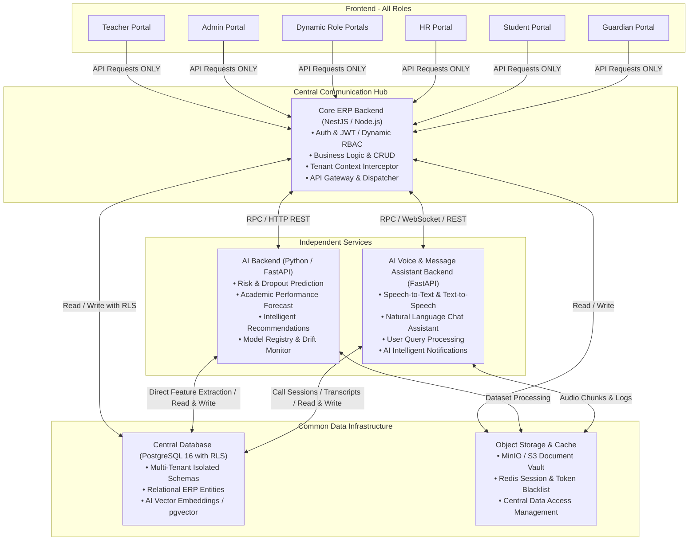

## Project Proposal of Final Semester - 2026

## Department of Computer Science and Engineering
### Daffodil Institute of IT (DIIT)

---

# Next-Generation AI-Driven Smart Education Management System

---

### Submitted By (Group Members):

| Detail | Group Member (1) | Group Member (2) |
| :--- | :--- | :--- |
| **Student Name** | **MD. Maruf Ahmmed** | **Sojib Chandra Roy** |
| **Class ID** | `210006` | `210005` |
| **Registration No** | `20502005439` | `20502005384` |
| **Session** | `2020–2021` | `2020–2021` |
| **Department** | Computer Science and Engineering (CSE) | Computer Science and Engineering (CSE) |
| **Institution** | Daffodil Institute of IT (DIIT) | Daffodil Institute of IT (DIIT) |

---

### 1. Project Title
**Next-Generation AI-Driven Smart Education Management System**  

---

### 2. Main Objectives
The core purpose of this project is to transform traditional administrative educational software into an active, intelligent, and predictive institutional operating system. The targeted objectives include:

- **Real-Time Performance & Behavioral Monitoring:** Track academic performance (GPA, continuous assessments, course milestones), daily attendance (biometric and schedule-based), and assignment lifecycles in real time.
- **AI-Based Personalized Learning Suggestions:** Deploy machine learning models that analyze individual learning paces, detect learning gaps, and deliver tailored recommendations and instructional resource paths.
- **Automated Dual-Channel Stakeholder Communication:** Keep guardians and parents actively engaged through instantaneous, automated notifications (SMS, Email, and Push) regarding student attendance, exam alerts, fee dues, and academic flags.
- **Faculty Intelligence & Pedagogical Enhancement:** Provide educators with granular cohort insights, early risk detection (dropout / failing probability), and data-backed instructional suggestions to optimize teaching outcomes.
- **Streamlined Institutional Administration:** Unify governance across 32 modular domains—from admissions, grading, and dynamic role-based access control (RBAC) to finance, hostel, and digital asset tracking—under a single, secure multi-tenant architecture.

---

### 3. Key Features *(Derived from Existing System Analysis)*

Based on the architectural codebase and modular ERP foundations, the system features a comprehensive suite of enterprise capabilities:

| Functional Cluster | Core Modules & Capabilities |
| :--- | :--- |
| **Intelligent Core & Analytics** | • **AI Academic Risk Predictor:** Early dropout detection and GPA forecasting using ML regression and classification. • **AI Voice & Chatbot Assistant:** Independent conversational voice/text assistant for student query resolution and automated parent announcements. • **Automated Conflict Detection Engine:** Prevents teacher, room, and schedule overlaps across academic timetables. |
| **Universal Security & RBAC** | • **Universal Automated Credential Engine:** Automatically provisions unique usernames and cryptographic temporary passwords for any standard or dynamic role. • **Zero Plain-Text Policy:** Industry-standard password hashing (bcrypt / Argon2id) with mandatory password changes upon first login. • **32-Module RBAC Matrix:** Granular permission toggles (`read`, `create`, `update`, `delete`, `export`, `approve`) across all institutional faculties. |
| **Academics & Life-Cycle** | • **Student & Faculty Information Management:** Complete digital portfolios, transcripts, attendance, and ID card generation. • **Admissions & Dual Provisioning Pipeline:** Single-step enrollment that concurrently establishes verified student and guardian portal credentials. • **Automated Examination & Grading Engine:** Exam hall assignments, dynamic grading policies, CGPA tabulation, and verifiable PDF transcripts with QR verification. |
| **Finance, Logistics & Operations** | • **Integrated Fee & Accounting Ledger:** Multi-tiered fee structures, digital invoicing, partial payment tracking, and ledger reconciliation. • **Campus Operations Vault:** Dedicated management modules for Library Catalogs, Hostel Allocations, Fleet/Transport Routes, and Asset Inventory. |

---

### 4. Methodology & Framework

The platform follows a **Decoupled Tiered Microservices / Modular Architecture** adhering to strict enterprise boundaries:

#### Technical Stack Summary:
1. **Frontend Tier:** Next.js 16 (App Router), React 19, Tailwind CSS, Lucide Icons, Client Route Guards.
2. **Central Hub (Core ERP):** Node.js, Express, TypeScript, JWT (JSON Web Tokens), Role-Based Access Control Interceptor.
3. **AI Backend Tier:** Python, FastAPI, Scikit-Learn, PyTorch/Transformers for predictive modeling.
4. **Voice & Assistant Tier:** Python, FastAPI, WebSockets, Speech-to-Text (STT), Text-to-Speech (TTS), and Natural Language Query Processing.
5. **Shared Data Layer:** PostgreSQL 16 with Row-Level Security (RLS) policies for strict tenant data isolation, Redis cache, and S3-compatible Object Storage.

---

### 5.Business Perspective

- **Subscription-Based Multi-Tenant SaaS Model:** Tiered B2B SaaS pricing model (Basic, Standard, Enterprise) charged per-active-student per academic year, ensuring predictable recurring revenue (ARR).
- **Market Viability & Scalability:** High domestic and international market demand across primary, secondary, and higher education institutions seeking to replace fragmented legacy desktop systems with cloud-native automation.
- **Global Expansion & Ecosystem Integration:** Ready-to-scale modular architecture capable of white-label localization, custom multi-currency payment gateway integrations (bKash, Nagad, Stripe, SSLCommerz), and LMS interoperability (Moodle, Canvas, Google Classroom).

---

*Submitted to: Department of Computer Science and Engineering, Daffodil Institute of IT (DIIT)*  

Submitted by MD. Maruf Ahmmed & Sojib Chandra Roy

