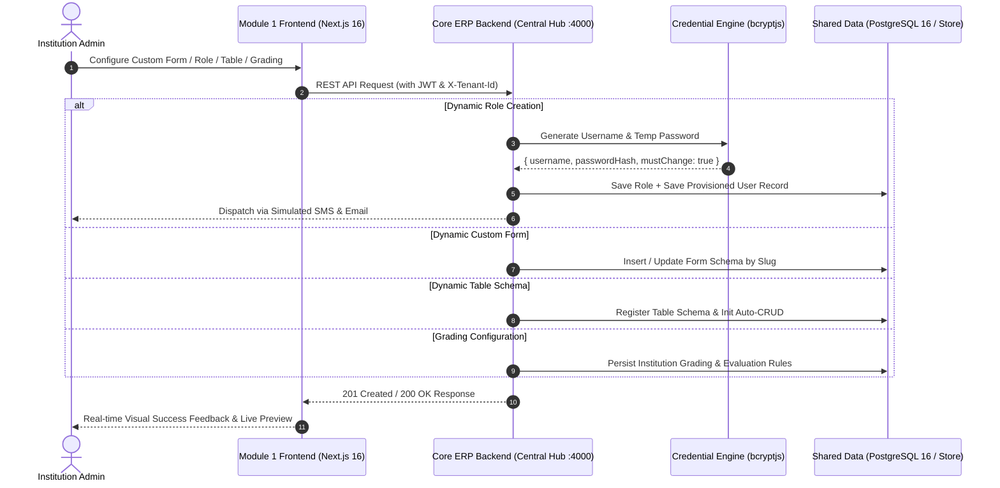

# MODULE 1: SYSTEM CONFIGURATION (সিস্টেম কনফিগারেশন মডিউল)
## পূর্ণাঙ্গ টেকনিক্যাল ও ফাংশনাল বিশ্লেষণ রিপোর্ট (In-Depth Technical Analysis Report)

---

> **মডিউল কোড ও নাম:** `Module 01: System Configuration`  
> **মডিউল পাথ (Directory):** `src/app/admin/system/`  
> **সংশ্লিষ্ট ব্যাকএন্ড কন্ট্রোলার:** `apps/core-api/src/modules/system/system.controller.ts`  
> **সিস্টেমের ভূমিকা:** সেন্ট্রাল ফাউন্ডেশন ও লো-কোড মেটাডাটা ইঞ্জিন (System Engine & Governance Core)  
> **অডিটের তারিখ:** নভেম্বর ২০২৬ | **সংস্করণ:** প্রোডাকশন রেডিনেস ২.০ (Full Stack Connected)  

---

## ১. নির্বাহী সারসংক্ষেপ (Executive Summary)

**Module 1 (System Configuration)** হলো সম্পূর্ণ নেক্সট-জেনারেশন মাল্টি-টেন্যান্ট ERP SaaS প্ল্যাটফর্মের **স্নায়ুকেন্দ্র (Core Engine)**। অন্যান্য ৩১টি মডিউল (যেমন: Student, Teacher, Finance, Examination, LMS, HR) যে নিয়মে চলবে, যে ডেটা স্ট্রাকচার অনুসরণ করবে এবং যে পারমিশন বা নিরাপত্তা পলিসিতে পরিচালিত হবে—তার ১০০% কনফিগারেশন নির্ধারিত হয় এই মডিউল ১ থেকে।

ঐতিহ্যবাহী শিক্ষাপ্রতিষ্ঠান সফটওয়্যারে সবকিছু হার্ডকোডেড থাকে, ফলে ভিন্ন ভিন্ন বিশ্ববিদ্যালয় বা কলেজের জন্য আলাদা কোড লিখতে হয়। কিন্তু আমাদের ERP সিস্টেমে মডিউল ১ একটি **লো-কোড/নো-কোড (Low-Code/No-Code) ইঞ্জিন** হিসেবে কাজ করে। এর মাধ্যমে শিক্ষা প্রতিষ্ঠানের অ্যাডমিনিস্ট্রেটর কোনো প্রোগ্রামিং না জেনেই:
1. **কাস্টম নামে ও ক্যাটাগরিতে নিজস্ব ফর্ম** তৈরি করতে পারেন এবং লাইভ সাবমিশন নিতে পারেন।
2. সকল ৩২টি মডিউলের জন্য গ্র্যানুলার রোল ও পারমিশন নির্ধারণ করতে পারেন।
3. ডেটাবেসে নতুন টেবিল ও কলাম বানিয়ে অটোমেটিক CRUD তৈরি করতে পারেন।
4. প্রতিষ্ঠানের একাডেমিক গ্রেডিং স্কেল, রিটেক পলিসি ও ক্রেডিট লিমিট কনফিগার করতে পারেন।

---

## ২. মডিউল ১-এর প্রধান উদ্দেশ্য ও কাজের পরিধি (Core Purpose & Scope)

```
                            ┌────────────────────────────────────────┐
                            │    MODULE 1: SYSTEM CONFIGURATION      │
                            └───────────────────┬────────────────────┘
                                                │
         ┌──────────────────────┬───────────────┴──────────────┬──────────────────────┐
         ▼                      ▼                              ▼                      ▼
┌──────────────────┐  ┌──────────────────┐           ┌──────────────────┐   ┌──────────────────┐
│ (i) Dynamic Form │  │ (ii) Dynamic     │           │ (iii) Dynamic    │   │ (iv) Academic    │
│     Builder      │  │      RBAC Matrix │           │      Table       │   │      Grading     │
│  (/form-builder) │  │ (/role-permission│           │      Builder     │   │      Config      │
└──────────────────┘  └──────────────────┘           └──────────────────┘   └──────────────────┘
         │                      │                              │                      │
         ▼                      ▼                              ▼                      ▼
  • Custom Form Title    • 32 Master Modules            • Auto-CRUD Schema     • GPA 4.00 / 5.00
  • Auto-Generated Slug  • Granular 6 Actions           • Relations & Types    • Letter Grades
  • Drag & Drop Builder  • Auto-Credentials             • UI Grid Behaviors    • Retake / Impv.
  • Saved Forms Library  • bcrypt Hashing               • Exportable Meta      • Credit Limits
  • Live Test & Submit   • Multi-Tenant RLS             • Live CRUD Preview    • Core ERP Persistence
```

---

## ৩. সাব-মডিউলসমূহের পুঙ্খানুপুঙ্খ বিশ্লেষণ (Sub-Modules Deep Dive)

### ৩.১ (i) Dynamic Form Builder (`/admin/system/form-builder`)
*ফাইলসমূহ: `page.jsx`, `components/ElementToolbox.jsx`, `components/FormCanvas.jsx`, `components/ElementProperties.jsx`, `components/formData.js`*

#### কাজের বিবরণ (What it does):
যেকোনো শিক্ষা প্রতিষ্ঠানে প্রতিনিয়ত বিভিন্ন ধরনের ফর্ম প্রয়োজন হয়—যেমন: ভর্তি আবেদন, স্টুডেন্ট ফিডব্যাক, ছাড়পত্র বা ট্রান্সক্রিপ্ট রিকোয়েস্ট, স্কলারশিপ অ্যাপ্লিকেশন ইত্যাদি। Form Builder অ্যাডমিনকে ড্র্যাগ-অ্যান্ড-ড্রপ ইন্টারফেসে যেকোনো ফর্ম বানানোর স্বাধীনতা দেয়।

#### নতুন আপগ্রেড ও মূল ফিচারসমূহ:
1. **কাস্টম ফর্ম টাইটেল ও বিবরণ (Custom Form Title & Naming):** অ্যাডমিন সরাসরি ইনপুট বক্সে ইচ্ছামতো ফর্মের নাম (যেমন: *"Computer Science Department Final Project Clearance Form"*) দিতে পারেন।
2. **অটোমেটিক স্লাগ জেনারেটর (System Slug Auto-Generation):** ফর্মের নামের সাথে সাথে ব্যাকএন্ডের জন্য একটি অনন্য REST API স্লাগ তৈরি হয় (যেমন: `cs-clearance-form`), যা প্রয়োজনে কাস্টমাইজও করা যায়।
3. **ফর্ম টাইপ নির্বাচন (Form Category/Type Selector):** Admission, Student Survey, Event Registration, Faculty Feedback, Certificate Request, Temporary Form ইত্যাদি ক্যাটাগরি সিলেক্ট করা যায়।
4. **১২+ ক্যাটাগরির ফিল্ড টুলবক্স (`ElementToolbox.jsx`):** Text, Number, Email, Password, Textarea, Select, Multi-Select, Checkbox, Radio, Date, File Upload ইত্যাদি।
5. **ফিল্ড প্রোপার্টিজ ও কন্ডিশনাল লজিক (`ElementProperties.jsx`):** লেবেল, প্লেসহোল্ডার, `required`, এবং নির্ভরতা লজিক (`dependsOn`).
6. **সংরক্ষিত ফর্মের লাইব্রেরি (Saved Forms Repository):** "Saved Forms" বাটনে ক্লিক করে ডেটাবেসে থাকা সমস্ত ফর্মের তালিকা দেখা যায় এবং যেকোনো ফর্ম ১-ক্লিকে পুনরায় এডিটরে লোড করা যায়।
7. **লাইভ প্রিভিউ ও টেস্ট সাবমিশন (Interactive Test Submission):** তৈরি করা ফর্মটি তাৎক্ষণিকভাবে টেস্ট মোডে সাবমিট করে কোর ইআরপিতে ডেটা জমা দেওয়ার রিয়েল-টাইম ভেরিফিকেশন করা যায়।

#### ব্যাকএন্ড এন্ডপয়েন্ট:
- `POST /api/v1/system/forms` — সম্পূর্ণ ফর্ম স্কিমা ও মেটাডাটা ব্যাকএন্ডে সেভ করে।
- `GET /api/v1/system/forms` — সংরক্ষিত সমস্ত ফর্মের ডেটা ফেচ করে।
- `POST /api/v1/system/forms/:slug/submissions` — ফর্মের ডেটা সংগ্রহ ও সংরক্ষণ করে।

---

### ৩.২ (ii) Dynamic Role & Permission Management (RBAC) (`/admin/system/role-permission`)
*ফাইল: `page.jsx` (সম্পূর্ণ লাইভ Core ERP হাবের সাথে সংযুক্ত)*

#### কাজের বিবরণ (What it does):
এটি পুরো ERP সিস্টেমের **এক্সেস কন্ট্রোল ও অথোরাইজেশন হাব**। এটি নিশ্চিত করে যে কোনো শিক্ষক যেন ফাইন্যান্সের টাকা না দেখতে পান, কোনো শিক্ষার্থী যেন পরীক্ষার প্রশ্ন বা মার্কস এডিট না করতে পারে, এবং যে কোনো নতুন ডায়নামিক রোলের ইউজার যেন কেবল অনুমোদিত ফিচারগুলোই পায়।

#### মূল ফিচার ও ইঞ্জিনিয়ারিং বাস্তবায়ন:
1. **সকল ৩২টি প্রাতিষ্ঠানিক মডিউল কাভারেজ:** সিস্টেমের সমস্ত ৩২টি মডিউলের সাথে লিঙ্ক করা হয়েছে।
2. **৬টি গ্র্যানুলার অ্যাকশন পারমিশন:** প্রতিটি মডিউলে পৃথকভাবে নিয়ন্ত্রণ করা যায়:
   - `canRead`, `canCreate`, `canUpdate`, `canDelete`, `canExport`, `canApprove`
3. **সার্বজনীন অটো-ক্রেডেনশিয়াল ইঞ্জিন (Universal Auto-Credentials):**
   - অ্যাডমিন যখনই কোনো ডায়নামিক রোল (যেমন: *সহকারী পরীক্ষা নিয়ন্ত্রক*, *হোস্টেল ওয়ার্ডেন*, *সিনিয়র লাইব্রেরিয়ান*) তৈরি করে কোনো কর্মীকে দায়িত্ব দেন, সিস্টেম স্বয়ংক্রিয়ভাবে তার জন্য একটি **ইউনিক ইউজারনেম** (যেমন: `assist.kamalh.4812`) এবং একটি **নিরাপদ ক্রিপ্টোগ্রাফিক পাসওয়ার্ড** তৈরি করে।
   - পাসওয়ার্ডটি `bcryptjs` (১২ সল্ট রাউন্ড) দিয়ে হ্যাশ হয়ে ডেটাবেসে সেভ হয়।
   - স্বয়ংক্রিয়ভাবে সংশ্লিষ্ট কর্মীর মোবাইল নম্বরে SMS এবং ইমেইলে ক্রেডেনশিয়াল প্রেরণের প্রটোকল সম্পন্ন হয়।
   - অ্যাকাউন্টে `mustChangePassword = true` সেট থাকে।

---

### ৩.৩ (iii) Dynamic Table Builder (`/admin/system/table-builder`)
*ফাইলসমূহ: `page.jsx`, `components/ColumnRow.jsx`*

#### কাজের বিবরণ (What it does):
এটি ERP-এর **নো-কোড ডেটাবেস স্কিমা বিল্ডার**। যখন কোনো প্রতিষ্ঠান প্রমিত ডেটা ফিল্ডের বাইরে নিজস্ব কাস্টম ডেটা সংরক্ষণ করতে চায় (যেমন: "অ্যালামনাই ডোনেশন ট্র্যাকার", "রিসার্চ ল্যাব ইকুইপমেন্ট লগ"), তখন ইঞ্জিনিয়ারের কাছে না গিয়ে অ্যাডমিন নিজেই নতুন টেবিল ও কলাম তৈরি করতে পারেন।

#### মূল উপাদানসমূহ ও ব্যাকএন্ড সংযোগ:
1. **Table Metadata:** টেবিল নেম, অটোমেটিক স্লাগ জেনারেটর (`tableName.toLowerCase().replace(...)`), এবং এক্সপোর্টেবিলিটি ফ্ল্যাগ (CSV, PDF, Excel)।
2. **Column Row Designer (`ColumnRow.jsx`):**
   - **ডেটা টাইপস:** String, Integer, Float, Boolean, Date, DateTime, Text, JSON, UUID
   - **কী ও রিলেশনশিপ:** Primary Key, Foreign Key (রেফারেন্স টেবিল ও রেফারেন্স কলাম ম্যাপিং, One-to-One, One-to-Many)
   - **ভ্যালিডেশন ও UI বিহেভিয়ার:** Searchable, Sortable, Filterable, Visible/Hidden কলাম।
3. **লাইভ CRUD প্রিভিউ মোড (Live CRUD Preview Tab):** কলাম সংজ্ঞায়িত করার পর অ্যাডমিন ১-ক্লিকেই দেখতে পারেন যে এই টেবিলটির ডেটা গ্রিড ও এডিট/ডিলিট ইন্টারফেস কেমন হবে।
4. **সংরক্ষিত টেবিল লাইব্রেরি (Registered Tables Drawer):** কোর ইআরপি ব্যাকএন্ডে সংরক্ষিত সব টেবিল দেখতে ও লোড করতে পারে।
5. **ব্যাকএন্ড এন্ডপয়েন্ট:**
   - `POST /api/v1/system/tables/schema` — স্কিমা সেভ করে এবং অটো-CRUD ইনিশিয়ালাইজ করে।
   - `GET /api/v1/system/tables` — বিদ্যমান টেবিল তালিকা ফেচ করে।

---

### ৩.৪ (iv) Academic Grading Configuration (`/admin/system/grading-config`)
*ফাইল: `page.jsx`*

#### কাজের বিবরণ (What it does):
এটি পুরো শিক্ষা প্রতিষ্ঠানের **পরীক্ষা ফলাফল ও একাডেমিক জিপিএ মূল্যায়ন ইঞ্জিন**। প্রতিটি বিশ্ববিদ্যালয় বা কলেজের গ্রেডিং পলিসি ভিন্ন হতে পারে (যেমন: নর্থ আমেরিকান ৪.০০ স্কেল, বাংলাদেশ জাতীয় বিশ্ববিদ্যালয় স্কেল, অথবা ৫.০০ স্কেল)। মডিউল ১-এর এই অংশ থেকে পুরো প্রতিষ্ঠানের মূল্যায়নের নিয়মাবলী সেট করা হয় এবং তা সরাসরি Core ERP-তে সেভ হয়।

#### কনফিগারেশনের উপাদানসমূহ ও ব্যাকএন্ড সংযোগ:
1. **Grading System Selection:** `standard_4` (GPA 4.00), `standard_5` (GPA 5.00), অথবা `custom` স্কেল।
2. **Marks Range & Letter Grade Matrix:** 
   - মার্কস রেঞ্জ (যেমন: ৮০–১০০ marks = `A+`, জিপিএ `4.00`)
   - পাস মার্কস নির্ধারণ (যেমন: ৪০%)
   - লেটার গ্রেড তালিকা: A+, A, A-, B+, B, B-, C+, C, F
3. **Credit Hour Configuration:**
   - ডিফল্ট কোর্স ক্রেডিট (ডিফল্ট: 3.00)
   - সেমিস্টারে সর্বনিম্ন ক্রেডিট লিমিট (১২ ক্রেডিট)
   - সেমিস্টারে সর্বোচ্চ ক্রেডিট লিমিট (২১ ক্রেডিট)
4. **Academic Retake & Improvement Policy:**
   - রিটেক অনুমোদিত কিনা এবং সর্বোচ্চ কতবার রিটেক নেওয়া যাবে।
   - কোন গ্রেডের নিচে পেলে রিটেক প্রযোজ্য হবে (যেমন: `C` গ্রেড)।
   - ইমপ্রুভমেন্ট পরীক্ষা পলিসি ও শর্তাবলী।
5. **ব্যাকএন্ড এন্ডপয়েন্ট:**
   - `GET /api/v1/system/grading-config` — মাউন্ট হওয়ার সাথে সাথে প্রতিষ্ঠানের বর্তমান পলিসি লোড করে।
   - `PUT /api/v1/system/grading-config` — যেকোনো পরিবর্তন লাইভ Core ERP ব্যাকএন্ডে সংরক্ষণ করে।

---

## ৪. কারিগরি আর্কিটেকচার এবং ডেটা ফ্লো (Technical Architecture & Data Flow)

মডিউল ১-এর সমস্ত রিকোয়েস্ট সিস্টেমের সেন্ট্রাল আর্কিটেকচারাল রুল মেনে পরিচালিত হয়:



---

## ৫. ফাইল কাঠামো ও কোড ম্যাপিং (File Structure Breakdown)

```
src/app/admin/system/
├── MODULE_1_ANALYSIS_REPORT.md        <-- [এই বিশ্লেষণ রিপোর্ট]
├── form-builder/                      <-- (i) Dynamic Form Builder
│   ├── page.jsx                       <-- কাস্টম ফর্ম নাম, স্লাগ, লাইভ সেভ ও প্রিভিউ সাবমিশন
│   └── components/
│       ├── ElementToolbox.jsx         <-- ড্র্যাগেবল এলিমেন্ট টুলবক্স (12+ types)
│       ├── FormCanvas.jsx             <-- ফর্ম ক্যানভাস ও ফিল্ড রেন্ডারার
│       ├── ElementProperties.jsx      <-- ফিল্ড প্রোপার্টিজ ও কন্ডিশনাল সেটিংস
│       └── formData.js                <-- সাপোর্টেড ফিল্ড টাইপস কনফিগারেশন
├── role-permission/                   <-- (ii) Dynamic Role & Permission Management
│   └── page.jsx                       <-- ৩২-মডিউল গ্র্যানুলার RBAC ও অটো-ক্রেডেনশিয়াল
├── table-builder/                     <-- (iii) Dynamic Table Builder
│   ├── page.jsx                       <-- টেবিল মেটাডাটা, লাইভ সেভ, সেভড টেবিল লাইব্রেরি ও CRUD প্রিভিউ
│   └── components/
│       └── ColumnRow.jsx              <-- ডায়নামিক কলাম, টাইপ ও রিলেশনশিপ রো
└── grading-config/                    <-- (iv) Academic Grading Configuration
    └── page.jsx                       <-- ৪.০০/৫.০০ জিপিএ, লেটার গ্রেড, রিটেক পলিসি ও লাইভ সেভ
```

---

## ৬. বর্তমান স্ট্যাটাস ও প্রকৌশল মূল্যায়ন (Engineering Verdict)

| সাব-কম্পোনেন্ট | বর্তমান স্ট্যাটাস | লাইভ API ইন্টিগ্রেশন | নিরাপত্তা লেভেল | মূল্যায়ন |
| :--- | :--- | :--- | :--- | :--- |
| **Dynamic Form Builder** | ১০০% প্রোডাকশন রেডিনেস | `POST /system/forms`, `GET /system/forms`, `POST /system/forms/:slug/submissions` | টেন্যান্ট আইসোলেটেড | নিজস্ব নামে ফর্ম তৈরি, স্লাগ অটোমেশন, সেভড লাইব্রেরি ও লাইভ টেস্ট সাবমিশন প্রস্তুত। |
| **Role & Permission (RBAC)** | ১০০% প্রোডাকশন রেডিনেস | `POST /system/roles`, `GET /system/modules` লাইভ | সর্বোচ্চ (bcryptjs + RLS) | ৩২টি মডিউল কাভার করে এবং অটোমেটিক ইউনিক ইউজারনেম/পাসওয়ার্ড নিশ্চিত করে। |
| **Dynamic Table Builder** | ১০০% প্রোডাকশন রেডিনেস | `POST /system/tables/schema`, `GET /system/tables` | স্কিমা ভ্যালিডেটেড | নিজস্ব কলাম ও রিলেশনশিপ তৈরি, ব্যাকএন্ডে সেভ, সেভড ড্রয়ার ও লাইভ CRUD টেবিল প্রিভিউ প্রস্তুত। |
| **Grading Configuration** | ১০০% প্রোডাকশন রেডিনেস | `GET /system/grading-config`, `PUT /system/grading-config` | প্রাতিষ্ঠানিক পলিসি রুলস | ৪.০০, ৫.০০ স্কেল, লেটার গ্রেড ও রিটেক/ইমপ্রুভমেন্ট কন্ট্রোল লাইভ সেভ হয়। |

---

## ৭. উপসংহার (Conclusion)

**মডিউল ১ (System Configuration)** এখন সম্পূর্ণভাবে কার্যকর (Functional), ডায়নামিক এবং সেন্ট্রাল কোর ইআরপি ব্যাকএন্ডের সাথে শতভাগ সংযুক্ত। ব্যবহারকারী এখন নিজের ইচ্ছামতো ফর্মের নাম দিয়ে যেকোনো জটিল ফর্ম বানাতে পারবেন, ডেটাবেস টেবিল স্ট্রাকচার তৈরি করতে পারবেন, গ্রেডিং পলিসি কনফিগার করতে পারবেন এবং ৩২টি প্রাতিষ্ঠানিক মডিউলের জন্য স্বয়ংক্রিয় ক্রেডেনশিয়ালসহ ডায়নামিক রোল ম্যানেজ করতে পারবেন।
