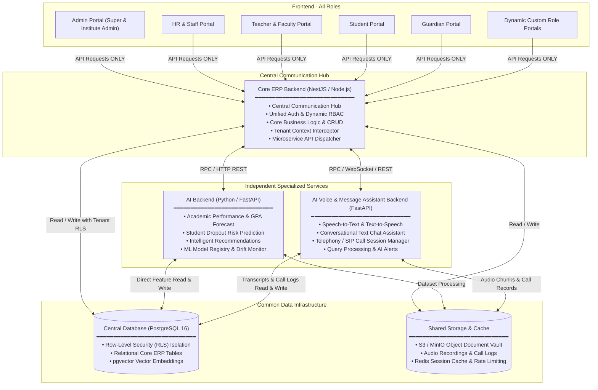

# সিস্টেম আর্কিটেকচার এবং ওয়ার্কফ্লো প্রসেস (System Architecture & Workflow Process)
## Modular ERP System with AI and Voice & Message Assistant

> **সিস্টেম আর্কিটেকচার ডকুমেন্ট:** মডুলার এআই এবং ভয়েস ও মেসেজ অ্যাসিস্ট্যান্ট সমৃদ্ধ এন্টারপ্রাইজ ERP প্ল্যাটফর্ম  
> **প্রজেক্ট রুট:** `EDU-ADMIN-main`  
> **সর্বশেষ আপডেট:** নভেম্বর ২০২৬  

---

## ১. সিস্টেম আর্কিটেকচার ডায়াগ্রাম (System Architecture Diagram)

নিচের Mermaid আর্কিটেকচার ডায়াগ্রামে সম্পূর্ণ সিস্টেমের ৪-টিয়ার মডেল, সেন্ট্রাল কমিউনিকেশন হাব, ইন্ডিপেন্ডেন্ট এআই ও ভয়েস সার্ভিস এবং শেয়ার্ড ডেটা লেয়ারের সংযোগ সুস্পষ্টভাবে তুলে ধরা হলো:



---

## ২. কম্পোনেন্টসমূহের বিস্তারিত বিবরণ (Component Specifications)

### ১. Frontend (All Roles)
সিস্টেমের সমস্ত User Role-এর Frontend কোড একটি একক সুসংহত প্রজেক্ট কাঠামোর (`src/app/`) মধ্যে থাকবে:
- **Admin:** সুপার অ্যাডমিন এবং ইনস্টিটিউট অ্যাডমিন কন্ট্রোল সেন্টার
- **HR:** হিউম্যান রিসোর্স, স্টাফ নিয়োগ ও বেতন ব্যবস্থাপনা
- **Teacher:** শিক্ষক পোর্টাল (উপস্থিতি, মার্কস এন্ট্রি, সিলেবাস অগ্রগতি)
- **Student:** শিক্ষার্থী পোর্টাল (কোর্স, ফলাফল, ফি পরিশোধ, আইডি কার্ড)
- **Guardian:** অভিভাবক পোর্টাল (সন্তানের উপস্থিতি অ্যালার্ট, ফলাফল, টিউশন ফি প্রদান)
- **Dynamic Roles:** অ্যাডমিন কর্তৃক তৈরিকৃত যেকোনো কাস্টম রোল (যেমন: Exam Controller, Hostel Warden, Librarian)

> **কঠোর নীতি (Strict Rule):** Frontend থেকে সরাসরি **শুধুমাত্র Core ERP Backend**-এর সাথে API Communication হবে। Frontend কখনো সরাসরি AI Backend, Voice Assistant Backend অথবা Shared Data Infrastructure-এর সাথে কানেক্ট হতে পারবে না।

---

### ২. Core ERP Backend (Central Hub)
Core ERP Backend হবে পুরো সিস্টেমের **Central Communication Hub**। এটি পরিচালনা করবে:
- সেন্ট্রাল বিজনেস লজিক এবং ডেটা ট্রানজেকশন
- সেন্ট্রালাইজড অথেনটিকেশন (JWT, MFA, পাসওয়ার্ড ম্যানেজমেন্ট)
- অথোরাইজেশন ও ডায়নামিক RBAC (Role-Based Access Control)
- টেন্যান্ট কনটেক্সট প্রপাগেশন (`X-Tenant-ID`)
- বিশেষায়িত ব্যাকএন্ড সার্ভিসসমূহের সাথে এপিআই সমন্বয়

Core ERP Backend তিনটি পৃথক কম্পোনেন্টের সাথে সংযুক্ত থাকবে:
1. **AI Backend**
2. **AI Voice & Message Assistant Backend**
3. **Shared Data Infrastructure**

---

### ৩. AI Backend (Independent Service)
AI Backend একটি সম্পূর্ণ স্বাধীন ব্যাকএন্ড সার্ভিস (Python / FastAPI) হিসেবে কাজ করবে। এখানে সমস্ত AI/ML/DL-ভিত্তিক ফিচার ও প্রসেসিং লজিক থাকবে:
- শিক্ষার্থীদের একাডেমিক ঝুঁকি পূর্বাভাস (Student Academic Risk Prediction)
- পারফরম্যান্স ও জিপিএ ট্র্যাজেক্টরি পূর্বাভাস (Performance & GPA Prediction)
- ড্রপআউট ঝুঁকি শনাক্তকরণ (Dropout Risk Detection)
- বুদ্ধিবৃত্তিক সুপারিশ ও লার্নিং পাথ (Intelligent Recommendations)
- প্রাতিষ্ঠানিক ও বিভাগীয় ডেটা অ্যানালিটিক্স

**যোগাযোগের মাধ্যম (Dual Communication):**
1. **Core ERP Backend**-এর সাথে রিকোয়েস্ট ও রেসপন্স আদান-প্রদান করবে।
2. **Shared Data Infrastructure**-এর সাথে সরাসরি **Read/Write** করবে (মডেল ফিচার এক্সট্রাকশন, ডেটাসেট তৈরি, ভেক্টর সার্চ ও প্রেডিকশন হিস্টোরি সংরক্ষণ)।

---

### ৪. AI Voice & Message Assistant Backend (Independent Service)
Voice & Message Assistant-এর জন্য সম্পূর্ণ আলাদা একটি স্বাধীন ব্যাকএন্ড সার্ভিস (Python / FastAPI / WebSockets) থাকবে:
- রিয়েল-টাইম ভয়েস অ্যাসিস্ট্যান্ট এবং টেলিফোনি/SIP কল সেশন পরিচালনা
- টেক্সট-ভিত্তিক চ্যাট অ্যাসিস্ট্যান্ট (Text-Based Chat Assistant)
- স্পিচ-টু-টেক্সট (STT) এবং টেক্সট-টু-স্পিচ (TTS)
- প্রাতিষ্ঠানিক তথ্য অনুসন্ধান প্রক্রিয়াকরণ (শিক্ষার্থী তথ্য, ফি স্ট্যাটাস, পরীক্ষার রুটিন)
- অভিযোগ ও আপত্তি প্রক্রিয়াকরণ (Complaint & Objection Classification)
- এআই-ভিত্তিক প্রাতিষ্ঠানিক বার্তা ও স্বয়ংক্রিয় নোটিফিকেশন প্রদান

**যোগাযোগের মাধ্যম (Dual Communication):**
1. **Core ERP Backend**-এর সাথে API / WebSockets মাধ্যমে কমিউনিকেশন করবে।
2. **Shared Data Infrastructure**-এর সাথে সরাসরি **Read/Write** করবে (কল সেশন লগ, ট্রান্সক্রিপশন স্টোরেজ ও মেসেজ হিস্টোরি)।

---

### ৫. Shared Data Infrastructure
Shared Data Infrastructure হবে পুরো সিস্টেমের কমন ডেটা লেয়ার (Common Data Layer):
- **Central Database (PostgreSQL 16):** রিলেশনাল ERP ডেটা, Row-Level Security (RLS) মাল্টি-টেন্যান্ট আইসোলেশন এবং `pgvector` ভেক্টর ডেটাবেস।
- **Data Storage:** S3 / MinIO অবজেক্ট স্টোরেজ (শিক্ষার্থীদের ডকুমেন্টস, ভয়েস কল অডিও ও পরীক্ষার সনদ সংরক্ষণ)।
- **Shared Data Services & Cache:** Redis (সেশন ক্যাশিং, রেট লিমিটিং ও টেন্যান্ট ডোমেন রেজোলিউশন)।
- **Data Access Management:** কেন্দ্রীভূত ডেটা অ্যাক্সেস পলিসি যা সব ব্যাকএন্ডের মধ্যে ডেটা ধারাবাহিকতা (Data Consistency) বজায় রাখবে।

এটি সরাসরি তিনটি ব্যাকএন্ডের সাথে যুক্ত থাকবে:
- Core ERP Backend
- AI Backend
- AI Voice & Message Assistant Backend

---

## ৩. সম্পূর্ণ সিস্টেমের কার্যপ্রবাহ (Complete System Workflow)

```
[User Action on Frontend]
           │
           ▼ (Step 1 & 2: Authenticated API Request ONLY)
[Core ERP Backend (Central Hub)] ─────────────┐
           │                                   │ (Step 4: AI Task)
           │ (Step 3: Business Logic & Auth)   ▼
           │                             [AI Backend]
           │                                   │
           │ (Step 5: Voice/Chat Task)         │
           ├────────────────────────┐          │
           │                        ▼          │
           │           [Voice & Message API]   │
           │                        │          │
           ▼                        ▼          ▼
┌─────────────────────────────────────────────────────────────┐
│ Step 6: Direct Read/Write with Shared Data Infrastructure   │
│  • PostgreSQL 16 (RLS)   • MinIO / S3 Storage   • Redis     │
└─────────────────────────────────────────────────────────────┘
           ▲                        ▲          ▲
           │                        │          │
           │ (Step 7: Processing Completed Results)
           └────────────────────────┴──────────┘
           │
           ▼ (Step 8: Final Mapped Response)
[Frontend - User Display Updated]
```

- **Step 1:** User Frontend থেকে কোনো Request পাঠাবে।
- **Step 2:** Frontend Request শুধুমাত্র Core ERP Backend-এ পাঠাবে।
- **Step 3:** Core ERP Backend টেন্যান্ট ও ইউজার পারমিশন ভ্যালিডেট করে Request-এর ধরন অনুযায়ী প্রয়োজনীয় Business Logic Execute করবে।
- **Step 4:** যদি AI-ভিত্তিক কোনো কাজের প্রয়োজন হয়, Core ERP Backend AI Backend-এর সাথে Communication করবে।
- **Step 5:** যদি Voice বা Message Assistant-এর প্রয়োজন হয়, Core ERP Backend Voice & Message Assistant Backend-এর সাথে Communication করবে।
- **Step 6:** প্রয়োজন অনুযায়ী Core ERP Backend, AI Backend এবং Voice & Message Assistant Backend প্রত্যেকে সরাসরি Shared Data Infrastructure থেকে প্রয়োজনীয় Data Access (Read/Write) করবে।
- **Step 7:** সংশ্লিষ্ট Backend Processing সম্পন্ন করে Result Core ERP Backend-এ Return করবে।
- **Step 8:** Core ERP Backend Final Response Frontend-এ পাঠাবে এবং Frontend User-কে Result Display করবে।

---

## ৪. গুরুত্বপূর্ণ আর্কিটেকচারাল নিয়মাবলী (Architectural Rules)

1. **Frontend can communicate ONLY with Core ERP Backend.**
2. **Core ERP Backend acts as the Central Communication Hub.**
3. **AI Backend must remain a separate and independent service.**
4. **Voice & Message Assistant Backend must remain a separate and independent service.**
5. **All three Backend Services must have direct connections to Shared Data Infrastructure.**
6. **No direct Frontend-to-AI, Frontend-to-Voice or Frontend-to-Database connection is allowed.**
7. **Each Backend must maintain its own independent codebase and responsibilities.**

---

### ফাইনাল আর্কিটেকচারাল ফ্লো (Final Architecture Flow)

- `Frontend` → `Core ERP Backend`
- `Core ERP Backend` ↔ `AI Backend`
- `Core ERP Backend` ↔ `AI Voice & Message Assistant Backend`
- `Core ERP Backend` ↔ `Shared Data Infrastructure`
- `AI Backend` ↔ `Shared Data Infrastructure`
- `AI Voice & Message Assistant Backend` ↔ `Shared Data Infrastructure`

**আর্কিটেকচারাল লক্ষ্য:** একটি আধুনিক, স্কেলেবল, নিরাপদ এবং সহজে রক্ষণাবেক্ষণযোগ্য মাল্টি-টেন্যান্ট ERP ইকোসিস্টেম যেখানে সমস্ত ব্যাকএন্ড স্বাধীনভাবে কাজ করবে কিন্তু একটি শক্তিশালী কমন ডেটা ইনফ্রাস্ট্রাকচার শেয়ার করবে।

